# IntelliJ IDEA Offline Plugin Pack (Linux & Windows)

**Language / Dil:** **English** | [Türkçe](README.tr.md)

This folder contains a curated set of plugins for **IntelliJ IDEA (free tier, no Ultimate subscription)**. Everything is prepared to be **installed manually from disk on a Linux or Windows machine without internet access**.

* **Compatibility:** each plugin has its own minimum IntelliJ IDEA version (see the *IntelliJ IDEA* column in the [plugin list](#plugin-list)). The oldest supported version is **2021.3** (GenerateAllSetter); the **complete set needs 2026.2 or later**, because Atom Material Icons requires 2026.2. With 2026.1, everything except Atom Material Icons works. The graphical installer detects your IDEA version and only lets you select compatible plugins.
* All plugins were downloaded from JetBrains Marketplace as the newest versions for **build IU-262 (2026.2)**. The plugins are platform independent, except GitHub Copilot, which ships separate **Linux x64** and **Windows x64** packages (both included).
* Every plugin's dependencies were checked. All required dependencies are IntelliJ IDEA's own built-in components (Java, Maven, YAML, Markdown, Git…), so nothing else has to be downloaded.
* SpotBugs rule jars were downloaded from Maven Central and verified against their SHA-1 checksums.

---

## Contents

1. [Folder layout](#folder-layout)
2. [Installation](#installation)
3. [Recommended settings for offline use](#recommended-settings-for-offline-use)
4. [Plugin list](#plugin-list)
5. [What each plugin does and how to use it](#what-each-plugin-does-and-how-to-use-it)
6. [Code quality: SonarQube, Checkstyle, SpotBugs, PMD](#code-quality-tools)
7. [Optional plugins (need internet or extra components)](#optional-plugins)
8. [Customizing the installer](#customizing-the-installer)
9. [Troubleshooting](#troubleshooting)

---

## Folder layout

```
.
├── README.md                     ← this file (English)
├── README.tr.md                  ← Turkish version
├── plugin-installer.sh           ← GRAPHICAL INSTALLER, Linux (recommended)
├── plugin-installer.cmd          ← GRAPHICAL INSTALLER, Windows (double-click)
├── plugin-installer.ps1          ←   (used by plugin-installer.cmd)
├── plugin-installer.jar          ← installer program (runs on IDEA's bundled Java)
├── catalog.json                  ← plugin information shown in the installer (editable)
├── src/PluginInstaller.java      ← installer source code
├── install-plugins.sh            ← install-everything script without a GUI, Linux
├── install-plugins.cmd           ← install-everything script without a GUI, Windows
├── install-plugins.ps1           ←   (used by install-plugins.cmd)
├── SHA256SUMS.txt                ← file integrity checksums (of every file as stored, including parts)
├── plugins/                      ← plugins to install (.zip, DO NOT extract)
│   ├── *.zip.001, *.zip.002 …    ← large plugins split into parts (see below)
│   ├── *.zip.sha256              ← checksum of the joined zip
│   └── optional/                 ← plugins that need internet / extra components
├── spotbugs-rules/
│   ├── spotbugs-4.8/             ← for the SpotBugs IDE plugin (use these)
│   └── spotbugs-4.9/             ← for SpotBugs 4.9.x in Maven/Gradle builds
└── docs/images/                  ← screenshots used in this README and the installer
```

---

## Installation

Copy the whole folder to the target machine (USB drive, network share, …). To make sure nothing was corrupted while copying:

```bash
# Linux
sha256sum -c SHA256SUMS.txt
```

```powershell
# Windows (PowerShell, run inside the folder)
Get-Content SHA256SUMS.txt | ForEach-Object { $h, $f = $_ -split '\s+\*?', 2; if ((Get-FileHash $f -Algorithm SHA256).Hash -ne $h) { "MISMATCH $f" } }; "check finished"
```

### Option 1: Graphical installer (recommended)

A desktop program where you pick which plugins to install. **No Python and no separate Java installation are needed.** The program finds and uses the Java runtime bundled with IntelliJ IDEA (`<IDEA>/jbr/`). **It never connects to the internet**; everything is read from this folder.

**Linux:**

```bash
cd /path/to/Intellij-IDEA-Plugins
chmod +x plugin-installer.sh
./plugin-installer.sh
```

If IDEA is installed in a non-standard location or cannot be found, pass its installation directory:

```bash
./plugin-installer.sh --idea-home /opt/idea-IU-262.xxxx
```

**Windows:** double-click **`plugin-installer.cmd`**. It looks for IntelliJ IDEA under `C:\Program Files\JetBrains\`, `%LOCALAPPDATA%\Programs\`, JetBrains Toolbox and the installed-programs list in the registry, and picks the newest IntelliJ IDEA. If it cannot be found, pass the directory:

```powershell
.\plugin-installer.cmd -IdeaHome "C:\Program Files\JetBrains\IntelliJ IDEA 2026.2"
```

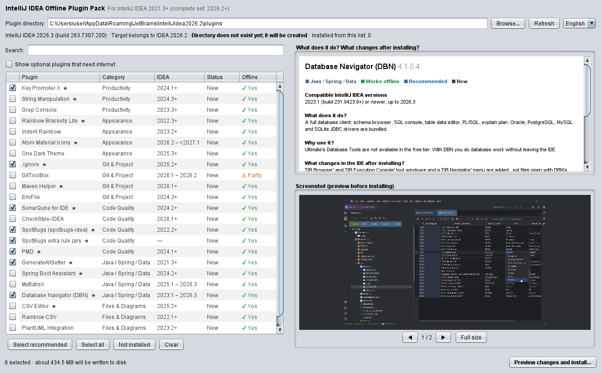

> The installer window is in **English** by default. Use the language box in the top right to switch to **Türkçe**; the choice is remembered.

**What the installer offers**

* **Plugin directory:** detected automatically from IDEA's `product-info.json` (Linux: `~/.local/share/JetBrains/IntelliJIdea2026.2`, Windows: `%APPDATA%\JetBrains\IntelliJIdea2026.2\plugins`). If `idea.plugins.path` is set in `idea.properties`, that path is used. You can change it with **Gözat…** (Browse).
* **Header:** shows the IntelliJ IDEA versions the pack supports (2021.3+, complete set 2026.2+).
* **List:** category, the **IntelliJ IDEA versions** each plugin supports, **status** (new / installed / will be updated / *incompatible*) and whether the plugin **works offline**. Plugins that do not support the IDEA version of the target directory are shown as *Incompatible* and cannot be selected. ★ marks recommended plugins. The search box searches names and descriptions.
* **Selection buttons:** select recommended, select all, select only plugins that are not installed yet or have an update, clear.
* **Details panel:** what the plugin does, why you would use it, **what will change in the IDE after installing it**, how to use it, requirements and warnings, target folder and the currently installed version.
* **Screenshot panel:** shows what the plugin looks like before you install it. GIFs are animated. Use **◀ ▶** to switch images; click the image or **Tam boyut** (full size) to enlarge.
* **Optional plugins that need internet** (Copilot, Claude Code, Line Profiler) are hidden by default and appear when the checkbox is ticked. Only the Copilot package for the current operating system is listed.
* Selecting the **SpotBugs extra rule jars** also selects SpotBugs automatically if it is not installed.

**Değişiklikleri önizle ve kur…** (preview changes and install) lists everything before anything is written: new install, update (old → new version) or reinstall, the folder each plugin is written to, what will change in the IDE, and the total disk space. It also warns when the IDE is running, the disk is full, a plugin needs internet, or a dependency is missing.

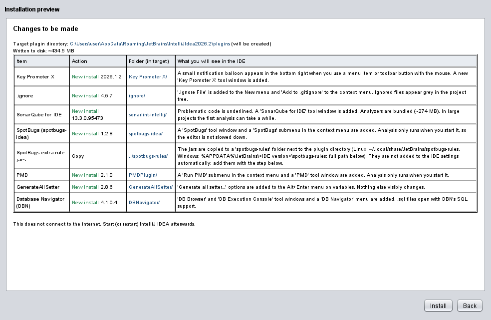

* When a plugin is updated or reinstalled, its **old folder is not deleted**; it is moved to `plugin-backups/<timestamp>/` next to the plugin directory (Linux: `~/.local/share/JetBrains/plugin-backups/`, Windows: `%APPDATA%\JetBrains\IntelliJIdea2026.2\plugin-backups\`). To roll back, move the folder back.
* SpotBugs rule jars are copied to `spotbugs-rules/` next to the plugin directory (Linux: `~/.local/share/JetBrains/spotbugs-rules/`, Windows: `%APPDATA%\JetBrains\IntelliJIdea2026.2\spotbugs-rules\`). At the end the installer shows how to add them in the SpotBugs settings.
* Start (or restart) IntelliJ IDEA after installing.

> On Linux the installer needs a graphical session (`DISPLAY` / Wayland). On a headless server reached over SSH, use **Option 3** (`install-plugins.sh`).
>
> The installer screenshots were rendered on Windows with IntelliJ IDEA's bundled Java (JBR 25) using the `--snapshot` option. On Linux the window looks the same apart from the window frame and fonts of your desktop environment.

### Option 2: From the IDE (one by one)

1. Open IntelliJ IDEA → **File › Settings** (`Ctrl+Alt+S`) → **Plugins**.
2. Click the **⚙ (gear)** icon in the top right → **Install Plugin from Disk…**
3. Select the **.zip file** under `plugins/`. Do not extract it; select the zip itself.
4. Repeat for each plugin, then click **Restart IDE**.

**Plugins split into parts** (`*.zip.001`, `*.zip.002` …) must be joined first; the installer and the scripts do this automatically:

```bash
# Linux
cat plugins/sonarlint-intellij-13.3.0.95473.zip.0* > /tmp/sonarlint-intellij-13.3.0.95473.zip
```

```powershell
# Windows
cmd /c copy /b plugins\sonarlint-intellij-13.3.0.95473.zip.001+plugins\sonarlint-intellij-13.3.0.95473.zip.002+plugins\sonarlint-intellij-13.3.0.95473.zip.003 %TEMP%\sonarlint-intellij-13.3.0.95473.zip
```

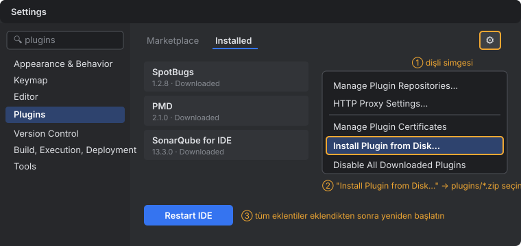

### About the split files

GitHub rejects files larger than 100 MB, so the three largest plugins are stored in 95 MB parts:

| Plugin | Parts |
|---|---|
| SonarQube for IDE | `sonarlint-intellij-13.3.0.95473.zip.001` – `.003` |
| GitHub Copilot (Linux x64) | `github-copilot-intellij-1.21.1-261-linux-x64.zip.001` – `.003` |
| GitHub Copilot (Windows x64) | `github-copilot-intellij-1.21.1-261-windows-x64.zip.001` – `.002` |

The graphical installer and both scripts join the parts into a temporary file, verify it against the `.zip.sha256` file and then install it. Nothing is downloaded. Keep all parts in the same folder.

### Option 3: Install everything with a script (no GUI)

Run while the IDE is **closed**:

```bash
cd /path/to/Intellij-IDEA-Plugins
chmod +x install-plugins.sh
./install-plugins.sh                 # all plugins under plugins/
./install-plugins.sh --optional      # + plugins under plugins/optional/
./install-plugins.sh --target ~/.local/share/JetBrains/IntelliJIdea2026.3   # different version/directory
```

The script extracts the zips into IntelliJ's plugin directory (`~/.local/share/JetBrains/IntelliJIdea2026.2/`). If an older version of the same plugin exists, it is removed first.

**Windows:** run **`install-plugins.cmd`** while the IDE is closed:

```powershell
.\install-plugins.cmd                      # all plugins under plugins\
.\install-plugins.cmd -Optional            # + plugins under plugins\optional\ (Windows Copilot only)
.\install-plugins.cmd -Target "$env:APPDATA\JetBrains\IntelliJIdea2026.3\plugins"
```

Default target: `%APPDATA%\JetBrains\IntelliJIdea2026.2\plugins`. Windows PowerShell 5.1 cannot write paths longer than 260 characters. With the default target this is not a problem; if you choose a deep `-Target` and an extraction fails, use a shorter path or the graphical installer (which has no such limit).

> **Note:** For a newer IDEA such as 2026.3 the directory name changes; pass it with `--target`. Most plugins only declare a minimum build, so they also load in newer versions. Plugins with an upper version limit: **Atom Material Icons** (≤ 271), **MyBatisX** and **Database Navigator** (≤ 263.\*), **GitToolBox** (≤ 262.\*). After upgrading the IDE you may need newer versions of these.

---

## Recommended settings for offline use

To stop the IDE from repeatedly trying to connect and showing warnings when there is no internet:

| Setting | Where |
|---|---|
| Turn off IDE and plugin update checks | **Settings › Appearance & Behavior › System Settings › Updates** → uncheck "Check IDE updates" and "Check for plugin updates" |
| Choose "No proxy" if there is no proxy | **Settings › Appearance & Behavior › System Settings › HTTP Proxy** |
| Turn off GitToolBox auto fetch (if no remote git server is reachable) | **Settings › Version Control › GitToolBox** → Auto Fetch |
| Use SonarQube without "Connected Mode" | Do not define a server connection; the default standalone mode works offline |
| Select the bundled Checkstyle version | **Settings › Tools › Checkstyle** → Checkstyle version: **14.4.0** (bundled with the plugin; other versions are downloaded from the internet) |

---

## Plugin list

| # | Plugin | Version | IntelliJ IDEA | File | Offline |
|---|---|---|---|---|---|
| 1 | Key Promoter X | 2026.1.2 | 2024.1+ | `Key_Promoter_X-2026.1.2.zip` | ✅ |
| 2 | String Manipulation | 9.16.0 | 2024.3+ | `StringManipulation-9.16.0.zip` | ✅ |
| 3 | Rainbow Brackets Lite | 1.3.0 | 2022.3+ | `intellij-rainbow-brackets-lite-1.3.0.zip` | ✅ |
| 4 | Indent Rainbow | 2.2.0 | 2023.2+ | `Indent_Rainbow-2.2.0-signed.zip` | ✅ |
| 5 | Grep Console | 13.3.0 | 2023.3+ | `GrepConsole-13.3.0-IJ2023.3.zip` | ✅ |
| 6 | .ignore | 4.5.7 | 2025.2+ | `ignore-4.5.7.zip` | ✅ |
| 7 | GitToolBox | 600.3.6 | 2026.1 – 2026.2 (build 261.23567+) | `gittoolbox-600.3.6_261-signed.zip` | ⚠️ paid features need an online license check |
| 8 | Maven Helper | 5.1.0 | 2026.1+ | `MavenHelper-5.1.0-IJ2026.1.zip` | ✅ (dependencies must be in a local repository) |
| 9 | EnvFile | 5.0.1 | 2024.3+ | `EnvFile-5.0.1.zip` | ✅ |
| 10 | SonarQube for IDE | 13.3.0 | 2024.2+ (build 242.20224.300+) | `sonarlint-intellij-13.3.0.95473.zip` (3 parts: `.001`–`.003`) | ✅ (standalone mode) |
| 11 | CheckStyle-IDEA | 26.20.0 | 2026.1+ | `checkstyle-idea-26.20.0.zip` | ✅ (bundled Checkstyle 14.4.0) |
| 12 | GenerateAllSetter | 2.8.6 | 2021.3+ | `GenerateAllSetter-2.8.6.zip` | ✅ |
| 13 | Spring Boot Assistant | 601.0.7 | 2024.2+ | `spring-boot-assistant-601.0.7_242.zip` | ✅ |
| 14 | MyBatisX | 1.7.9 | 2025.1 – 2026.3 | `MybatisX-1.7.9.zip` | ✅ |
| 15 | Database Navigator (DBN) | 4.1.0.4 | 2023.1 – 2026.3 (build 231.9423.9+) | `DBN-4.1.0.4.zip` | ✅ (JDBC drivers bundled) |
| 16 | CSV Editor | 252.56.1 | 2025.2+ | `intellij-csv-validator-252.56.1.zip` | ✅ |
| 17 | Rainbow CSV | 2.0.2 | 2022.1+ | `RainbowCSV.zip` | ✅ |
| 18 | PlantUML Integration | 7.15.0 | 2023.2+ (build 232.6734+) | `plantuml4idea-7.15.0-IJ2023.2.zip` | ✅ (some diagrams need Graphviz) |
| 19 | Mermaid Visualizer | 1.14.0 | 2025.3+ | `MermaidVisualizer-1.14.0.zip` | ✅ (mermaid.js bundled) |
| 20 | Atom Material Icons | 210.0.2 | 2026.2 – before 2027.1 | `Atom_Material_Icons-210.0.2.zip` | ✅ |
| 21 | One Dark Theme | 6.2.5 | 2025.3+ | `one-dark-theme-6.2.5.zip` | ✅ |
| 22 | **SpotBugs (spotbugs-idea)** | 1.2.8 | 2022.2+ (build 222.1+) | `spotbugs-idea-1.2.8.zip` | ✅ |
| 23 | **PMD** | 2.1.0 | 2024.1+ | `PMDPlugin-2.1.0.zip` | ✅ (PMD 7.21.0 bundled) |
| — | GitHub Copilot (Linux x64) | 1.21.1 | 2026.1+ | `optional/github-copilot-intellij-1.21.1-261-linux-x64.zip` (3 parts: `.001`–`.003`) | ❌ internet required |
| — | GitHub Copilot (Windows x64) | 1.21.1 | 2026.1+ | `optional/github-copilot-intellij-1.21.1-261-windows-x64.zip` (2 parts: `.001`–`.002`) | ❌ internet required |
| — | Claude Code [Beta] | 0.1.14-beta | 2024.2+ | `optional/claude-code-jetbrains-plugin-0.1.14-beta.zip` | ❌ CLI and API access required |
| — | Line Profiler | 1.10.0 | 2024.2+ | `optional/pycharm-lineprofiler-1.10.0.zip` | ⚠️ Python plugin required |

The *IntelliJ IDEA* column is each plugin's supported range, read from its `plugin.xml`. GitToolBox needs at least build 261.23567 (a 2026.1.x update) and SonarQube at least build 242.20224.300 (a 2024.2.x update).

**SpotBugs extra rule jars:**

| File | Folder | Compatible SpotBugs |
|---|---|---|
| `findsecbugs-plugin-1.14.0.jar` (Find Security Bugs) | `spotbugs-4.8/` and `spotbugs-4.9/` | built against 4.8.6; 4.8.x / 4.9.x |
| `sb-contrib-7.6.9.jar` | `spotbugs-4.8/` | 4.8.x (for 4.8.6 in the IDE plugin) |
| `sb-contrib-7.7.4.jar` | `spotbugs-4.9/` | 4.9.x (for Maven/Gradle builds) |

---

## What each plugin does and how to use it

> **About settings paths:** Menu and settings paths can differ slightly between IDE and plugin versions. If you cannot find one, type the plugin name into the **Settings** (`Ctrl+Alt+S`) search box.
>
> Screenshots were taken from each plugin's JetBrains Marketplace page; copyright belongs to the plugin authors. Some were captured with older IDE themes; the functionality is the same. Images marked *illustration* were drawn for this pack because the plugin has no screenshot on the Marketplace.

### 1. Key Promoter X

**What it does:** When you use a menu item or toolbar button with the mouse, it shows that action's keyboard shortcut as a notification in the bottom right. It suggests assigning a shortcut to frequently used actions that have none.

**Usage:**
* Works automatically after installation.
* **View › Tool Windows › Key Promoter X** shows statistics of the actions you most often perform with the mouse.
* Settings: **Settings › Tools › Key Promoter X**


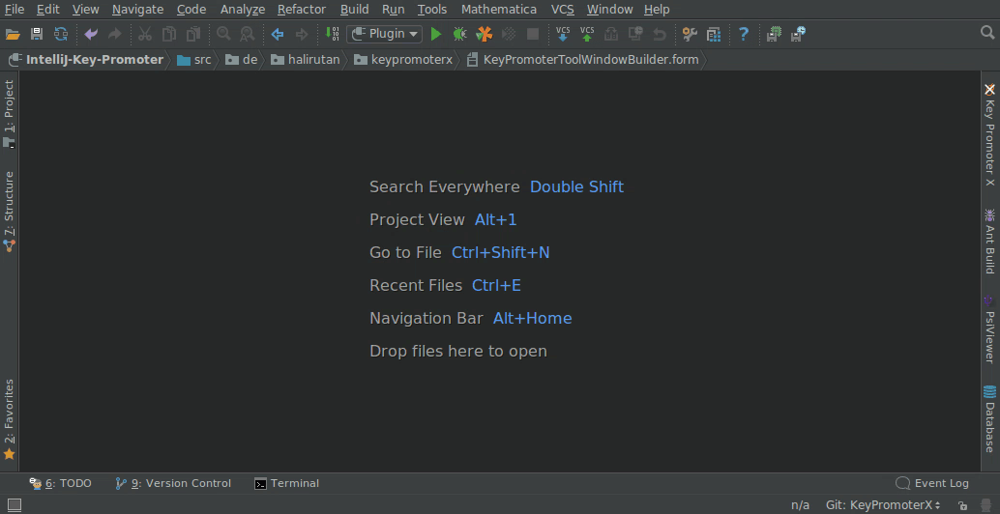

### 2. String Manipulation

**What it does:** Dozens of transformations on selected text: camelCase ↔ snake_case ↔ kebab-case ↔ CONSTANT_CASE, upper/lower case, sorting lines, removing duplicates, Base64/URL/HTML encode-decode, escaping, incrementing numbers and more.

**Usage:**
* Select text → `Alt+M` → choose an action from the popup.
* Or use **Edit › String Manipulation** or the context menu.
* Shortcuts and settings: **Settings › Other Settings › String Manipulation** (or search "string manipulation").


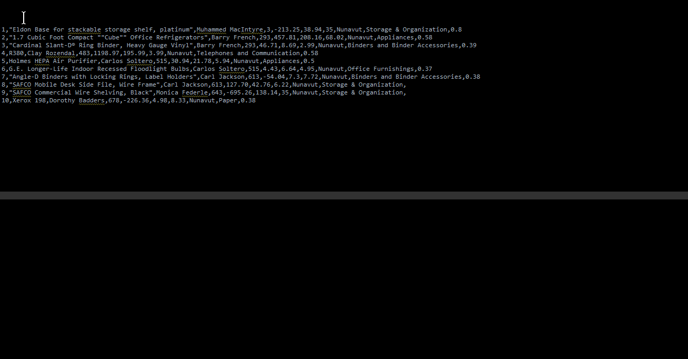

### 3. Rainbow Brackets Lite

**What it does:** Colors nested brackets `() [] {} <>` by depth, so you can see which bracket closes which. Free and open source version of the paid "Rainbow Brackets" plugin.

**Usage:** Works automatically. Colors: **Settings › Editor › Color Scheme › Rainbow Brackets** (search "rainbow" in Settings).

There is no screenshot on the Marketplace. The image below is an **illustration**:

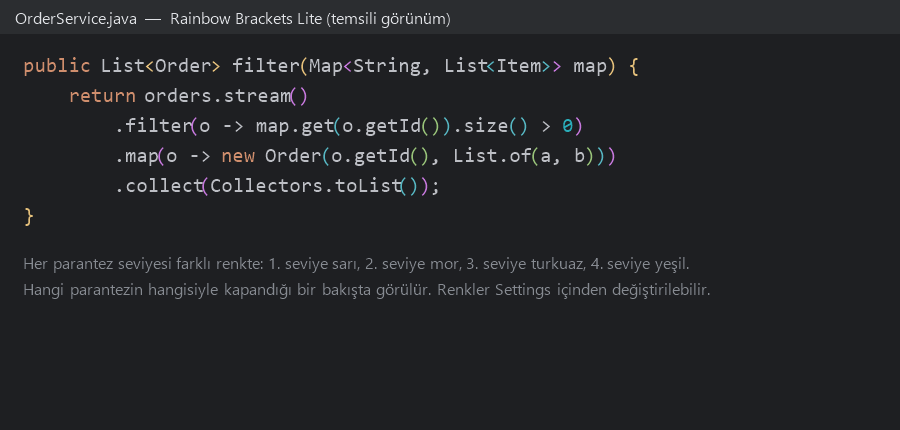

### 4. Indent Rainbow

**What it does:** Shows indentation levels as subtle colored stripes and highlights incorrect indentation in red. Very useful for YAML, Python and deeply nested XML.

**Usage:** Works automatically. Settings: **Settings › Editor › Indent Rainbow** (or search "indent rainbow").

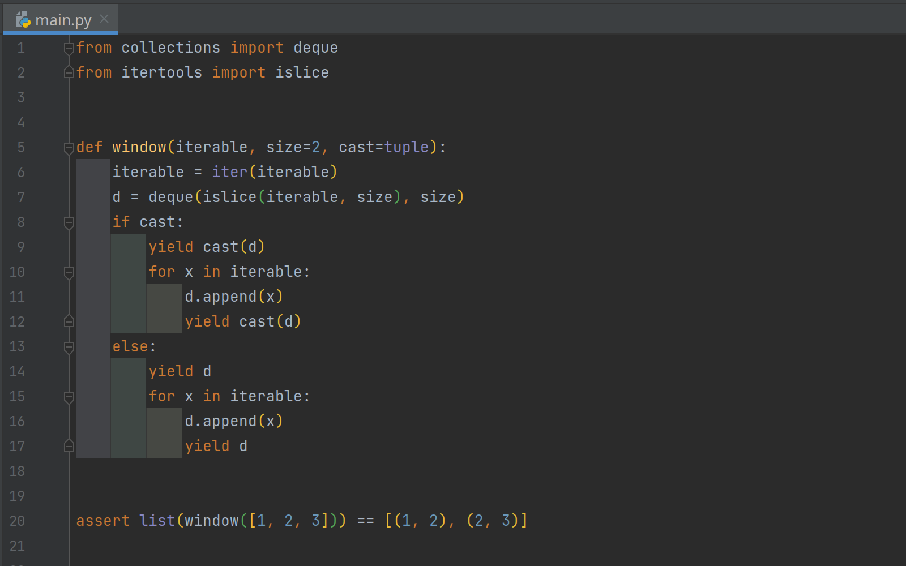

### 5. Grep Console

**What it does:** Colors, hides or filters lines in the Run/Debug console and in log files based on your own patterns. For example, make `ERROR` lines red and hide `DEBUG` lines.

**Usage:**
* Select text in the console → right click → **Grep** opens a new filtered console tab.
* Add rules from the Grep Console icon in the console toolbar or via **Settings › Other Settings › Grep Console**.
* With **Tail File** you can follow any log file live inside the IDE.

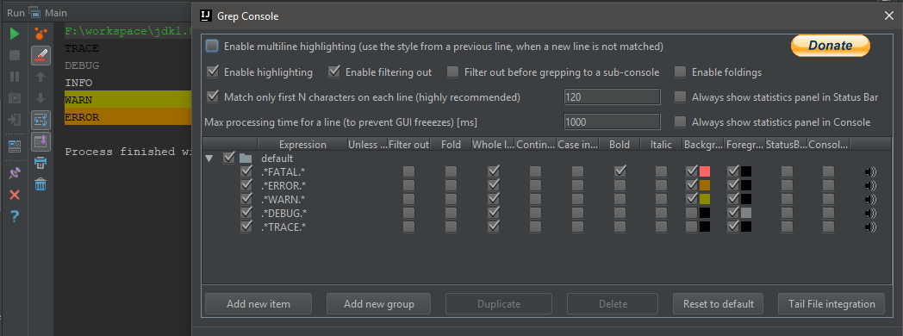

### 6. .ignore

**What it does:** Adds syntax highlighting and completion for `.gitignore`, `.dockerignore`, `.npmignore`, `.helmignore` and similar files. Generates `.gitignore` files from ready-made templates (Java, Maven, IntelliJ, Node…). Templates are bundled, no internet needed.

**Usage:**
* Right click in the project tree → **New › .ignore File › .gitignore File (Git)** → pick templates.
* Right click a file → **Add to .gitignore**
* Ignored files appear grey in the project tree.

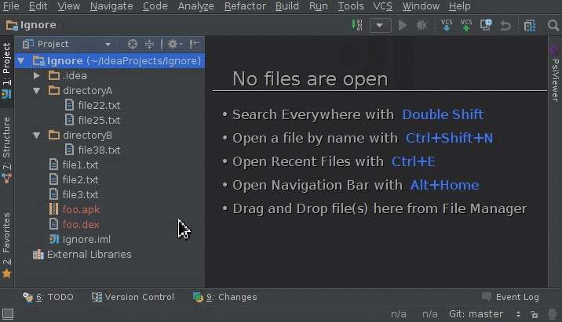
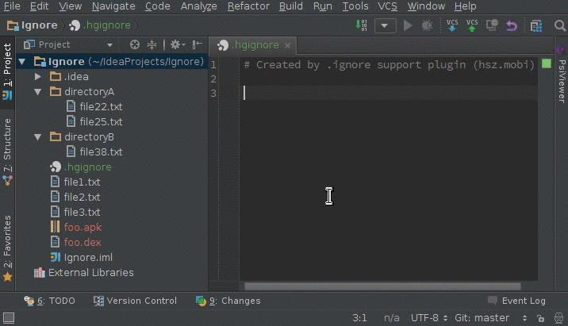

### 7. GitToolBox

**What it does:** Extends the Git integration: inline **blame** at the end of the current line (who, when, which commit), branch and ahead/behind status in the project tree, branch info in the status bar, commit message completion, auto fetch.

**Usage:**
* Works automatically. Settings: **Settings › Version Control › GitToolBox**
* Offline, turn off **Auto Fetch** if no git server is reachable.
* ⚠️ Freemium. Basic features are free. Some advanced features require a license, and license validation needs internet access.

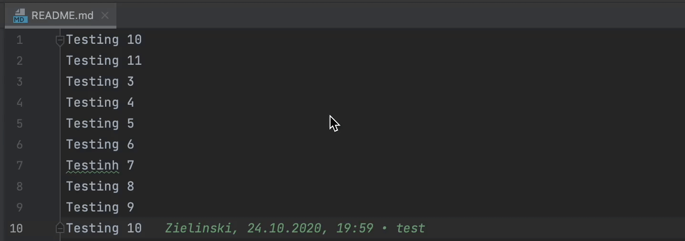
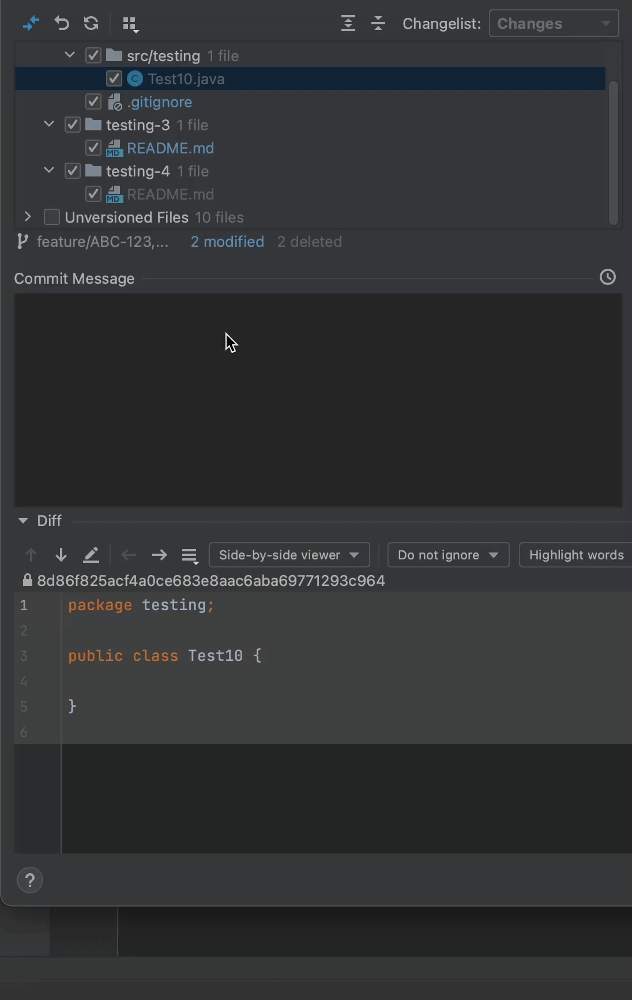

### 8. Maven Helper

**What it does:** Adds a **Dependency Analyzer** tab to `pom.xml`. Lists dependency conflicts (different versions of the same library), shows the dependency tree and adds an `<exclusion>` with one click. Also lets you run goals quickly from the context menu.

**Usage:**
* Open a `pom.xml` → switch to the **Dependency Analyzer** tab at the bottom of the editor.
* The **Conflicts** view lists conflicts → right click → **Exclude**.
* Right click in the project tree or editor → **Run Maven** / **Debug Maven**.
* Offline, dependencies must be available in the local `~/.m2` repository or an internal Nexus/Artifactory.

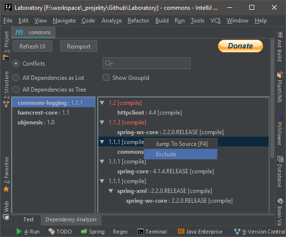
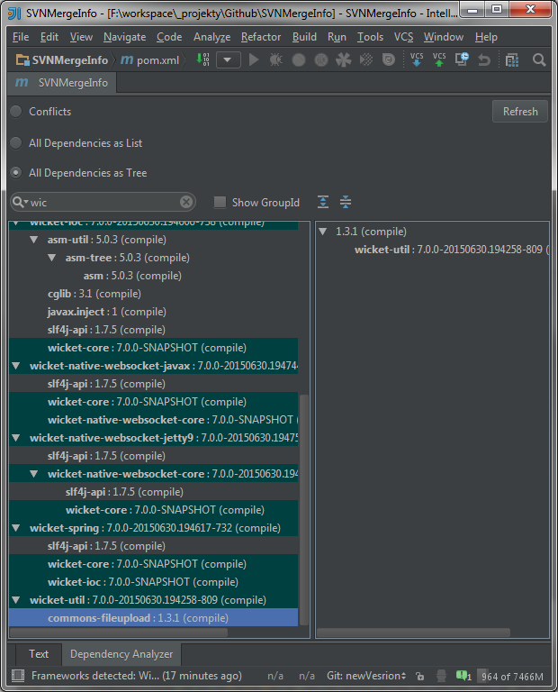

### 9. EnvFile

**What it does:** Loads environment variables into Run/Debug configurations from `.env`, `.json` or `.yaml` files, so you do not have to type them one by one.

**Usage:**
* **Run › Edit Configurations…** → select a configuration → **EnvFile** tab
* Check **Enable EnvFile** → add the `.env` file with **+**.

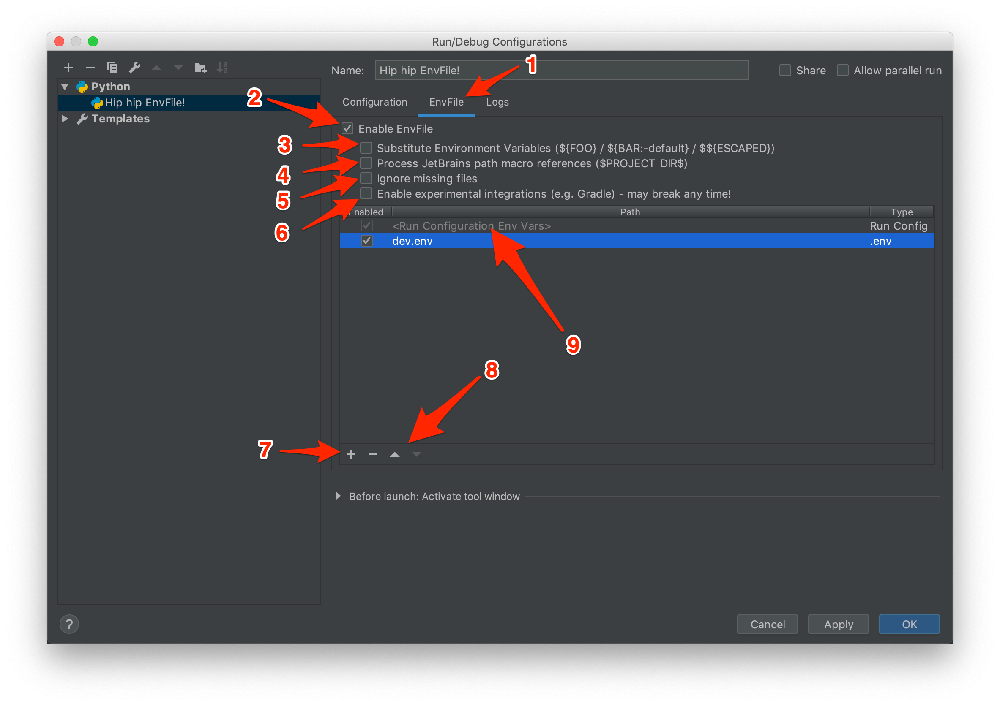

### 10–11. SonarQube for IDE, CheckStyle-IDEA

→ See [Code quality tools](#code-quality-tools).

### 12. GenerateAllSetter

**What it does:** Generates all `setXxx(...)` calls for an object at once (with default values or empty). Also generates getter → setter conversion code between two objects (DTO ↔ Entity). Works with Lombok `@Data` classes.

**Usage:**
* On a line like `User user = new User();` put the cursor on the variable name → `Alt+Enter`
* Choose **Generate all setter with default value** or **Generate all setter no default value**.
* When a method's return type and parameter differ → `Alt+Enter` → **Generate setter getter converter**

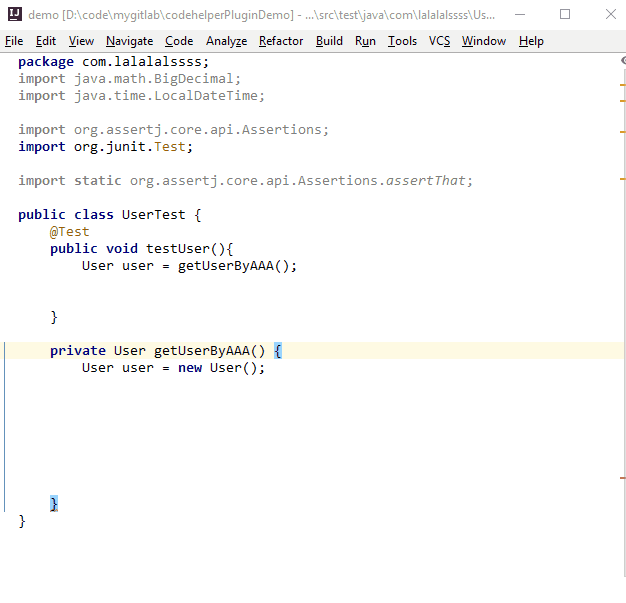
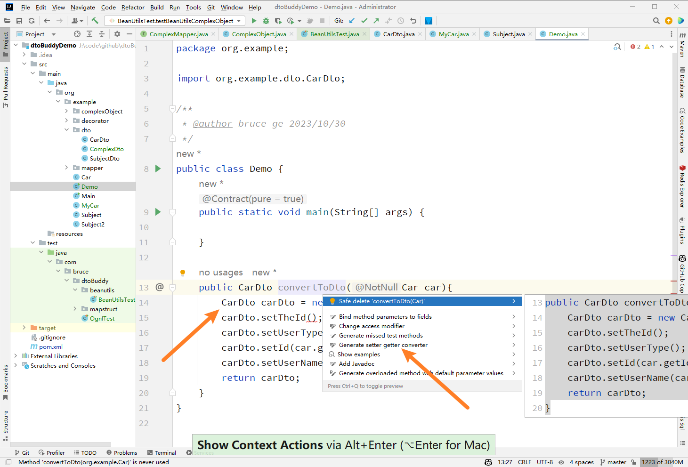

### 13. Spring Boot Assistant

**What it does:** Spring support is limited in the free tier of IntelliJ IDEA. This plugin adds **auto-completion**, documentation and go-to-source for Spring Boot configuration keys in `application.properties` and `application.yml`.

**Usage:**
* The project's Maven/Gradle dependencies must be resolved (available locally). The plugin reads `spring-configuration-metadata.json` from the dependency jars.
* Start typing in `application.yml`, e.g. `server.` → suggestions appear. `Ctrl+Q` shows the description.

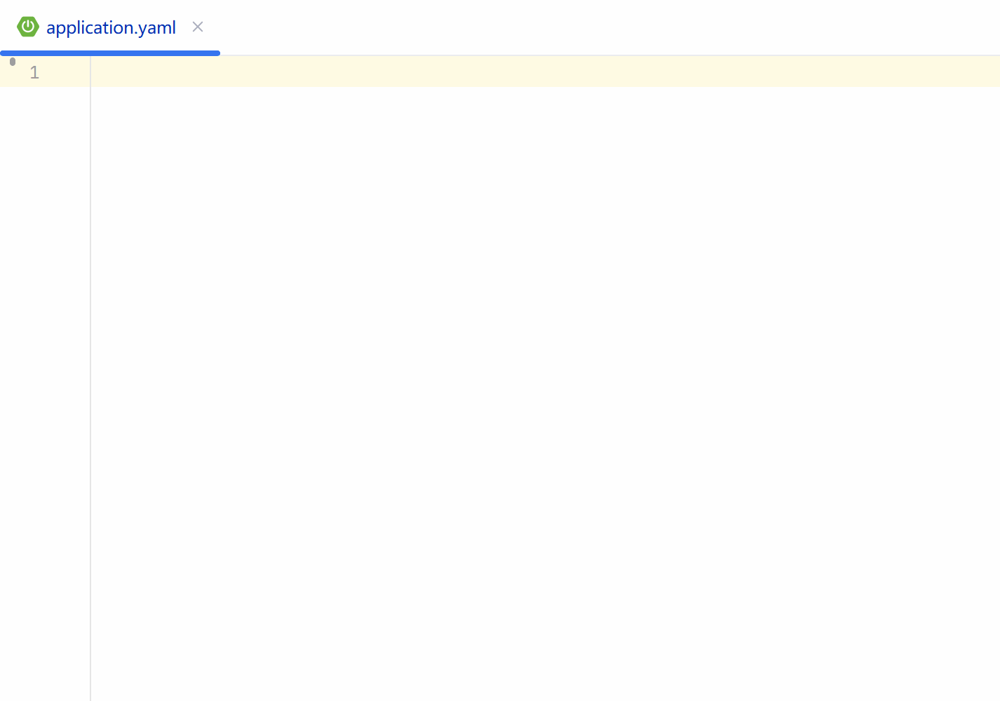

### 14. MyBatisX

**What it does:** In MyBatis projects, adds gutter icons to navigate between Mapper interfaces and XML mappers. Generates missing XML statements and completes `#{}` parameters.

**Usage:**
* Click the bird icon next to a mapper method → jumps to its XML counterpart (and back).
* `Alt+Enter` on a method name → **Generate statement**.

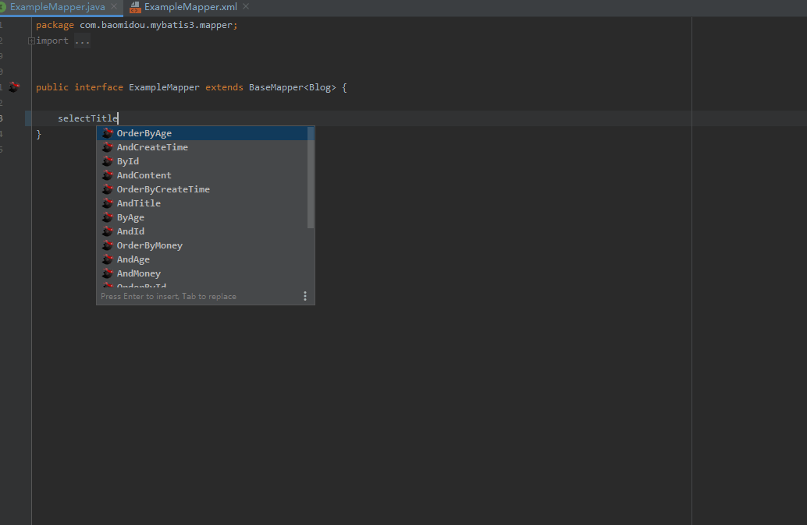

### 15. Database Navigator (DBN)

**What it does:** The Ultimate-only "Database Tools" plugin is not available in the free tier. DBN replaces it with a full database client: schema browser, SQL console, table data editor, PL/SQL support, explain plan.

**Bundled JDBC drivers (no internet needed):** Oracle (ojdbc17), PostgreSQL 42.7, MySQL Connector/J 9.5, SQLite 3.53.

**Usage:**
* **View › Tool Windows › DB Browser**
* **+** → choose the connection type (Oracle, PostgreSQL, MySQL, SQLite or Generic JDBC) → enter host, port, user and password.
* For other databases (e.g. MS SQL, DB2) choose **Driver source: External** and point to the driver jar on disk.
* Right click a connection → **Open SQL Console**, run with `Ctrl+Enter`.

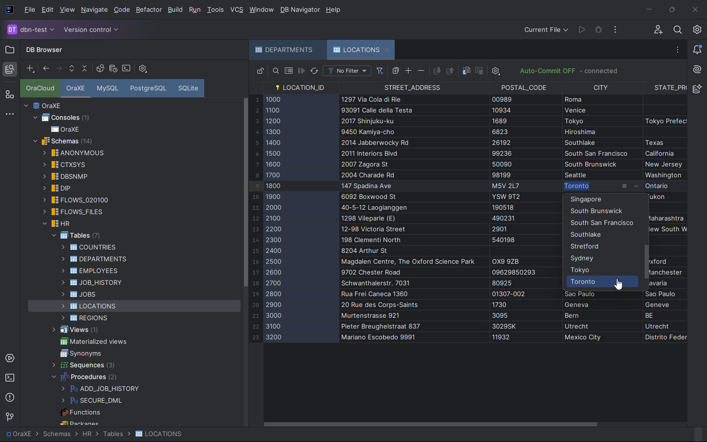
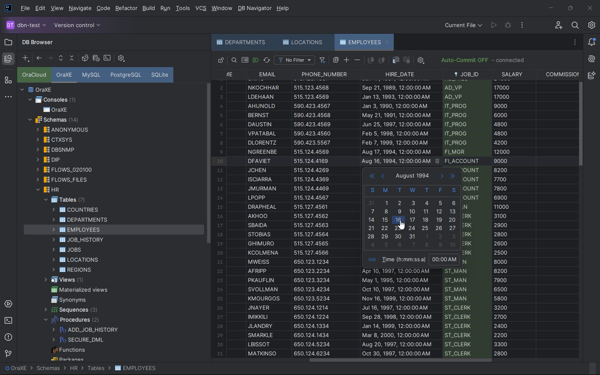

### 16. CSV Editor

**What it does:** Adds syntax validation, column highlighting and **table view editing** to CSV and TSV files. The separator (`,` `;` `|` `\t`) is detected automatically.

**Usage:** Open a `.csv` file → **Table Editor** tab at the bottom of the editor. Settings: **Settings › Editor › CSV/TSV/PSV**

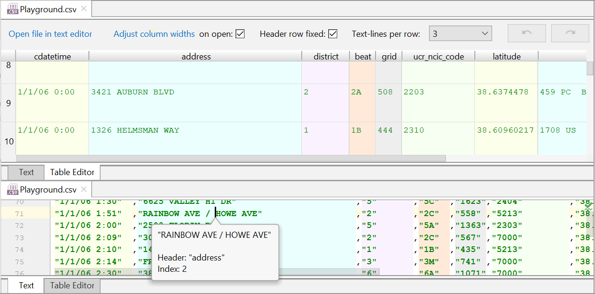
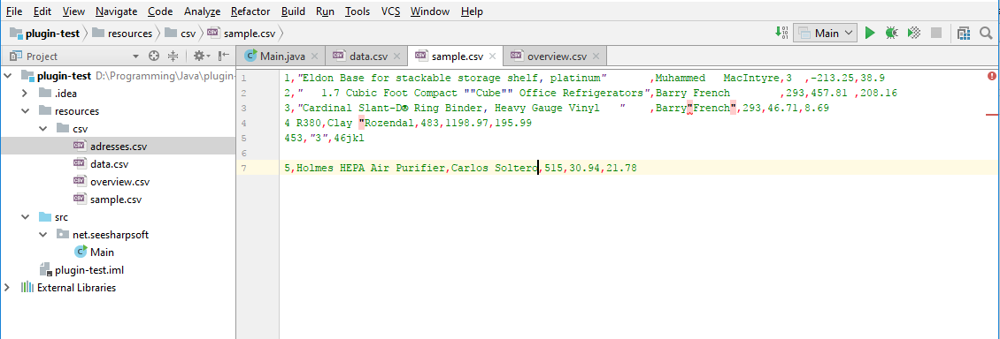

### 17. Rainbow CSV

**What it does:** Shows each CSV column in a different color, so you can tell at a glance which value belongs to which column. Can be used together with CSV Editor.

**Usage:** Works automatically.

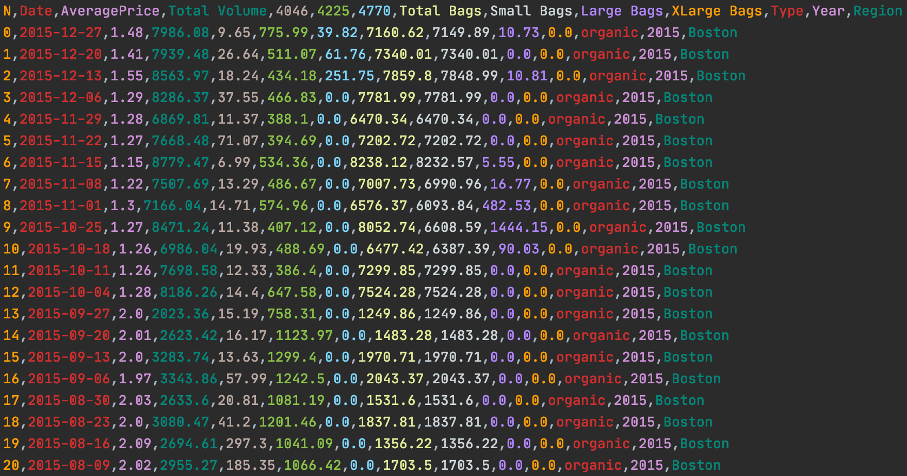

### 18. PlantUML Integration

**What it does:** Live preview for `.puml` / `.plantuml` files and `@startuml … @enduml` blocks in code. Supports class, sequence, activity, component and state diagrams. Exports to PNG/SVG. PlantUML (MIT edition 1.2026.8) is bundled.

**Usage:**
* **File › New › PlantUML File** → pick a type.
* The **PlantUML** tool window on the right shows a live preview.
* ⚠️ Some diagram types (class, component, state) need **Graphviz**. On an offline machine install the `graphviz` package from a local repository, or use the built-in Java layout engine by adding this line:
  ```
  @startuml
  !pragma layout smetana
  ...
  @enduml
  ```

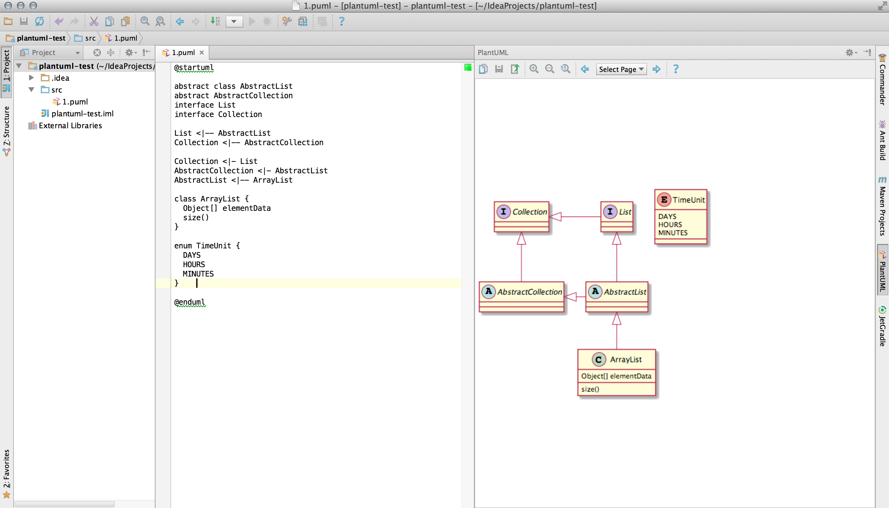
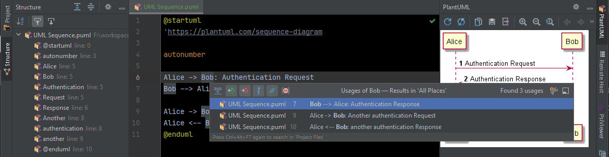

### 19. Mermaid Visualizer

**What it does:** Renders Mermaid diagrams (flowchart, sequence, class, ER, Gantt…) inside the IDE. ` ```mermaid ` blocks in Markdown files are shown as diagrams in the preview. `mermaid.js` is bundled; it does not load anything from a CDN.

**Usage:** Write a ` ```mermaid ` block in a Markdown file → open the Markdown preview.

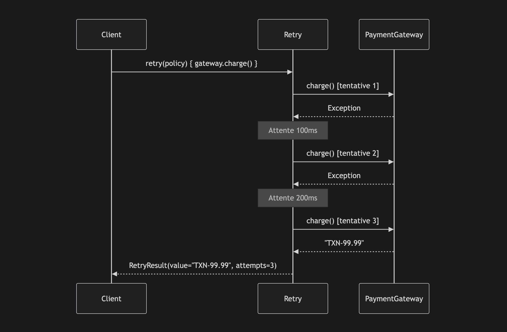
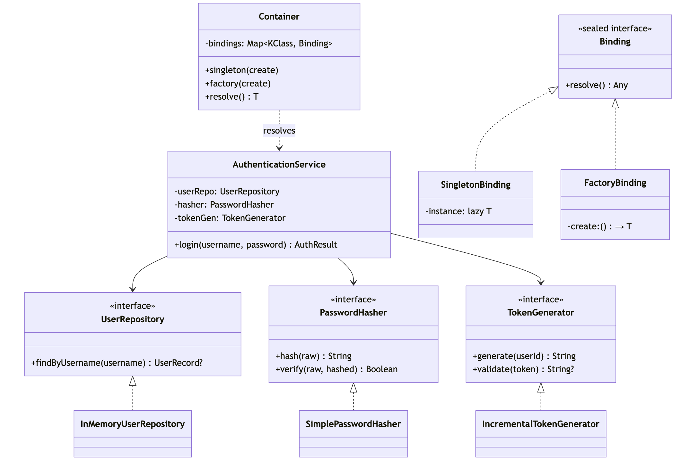

### 20. Atom Material Icons

**What it does:** Replaces file and folder icons in the project tree with distinctive, colorful icons per file type (pom.xml, Dockerfile, .yml, test folders…).

**Usage:** Works automatically. Settings: **Settings › Appearance & Behavior › Atom Material Icons**

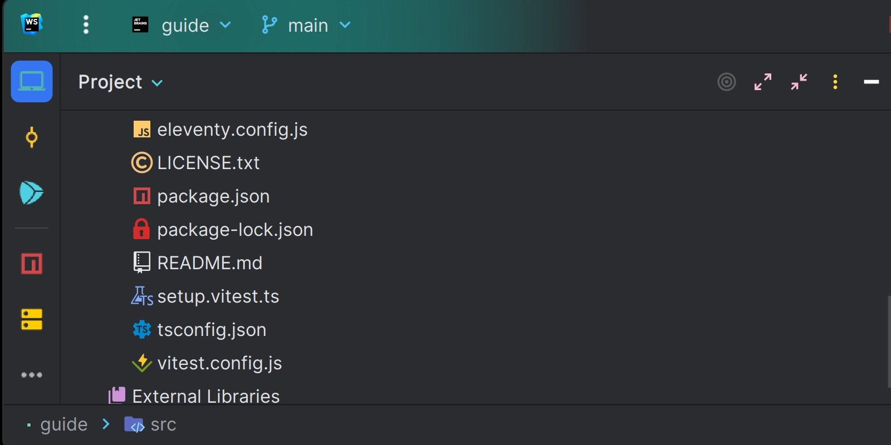
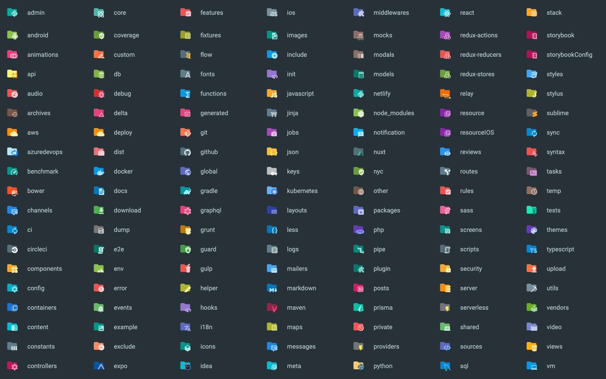

### 21. One Dark Theme

**What it does:** Brings the popular "One Dark" dark theme from the Atom editor to the IDE.

**Usage:** **Settings › Appearance & Behavior › Appearance › Theme** → **One Dark**

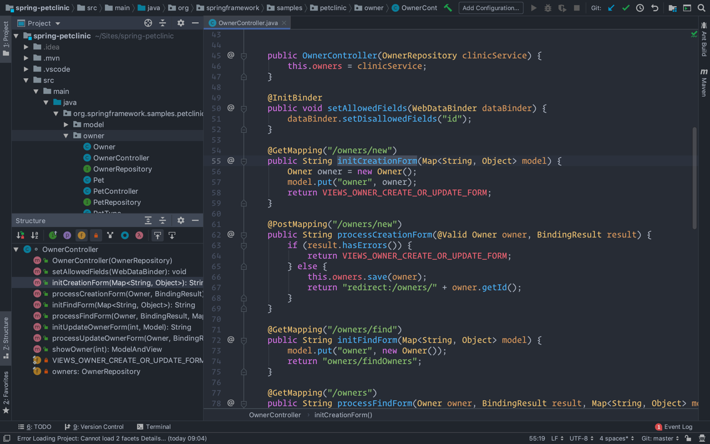
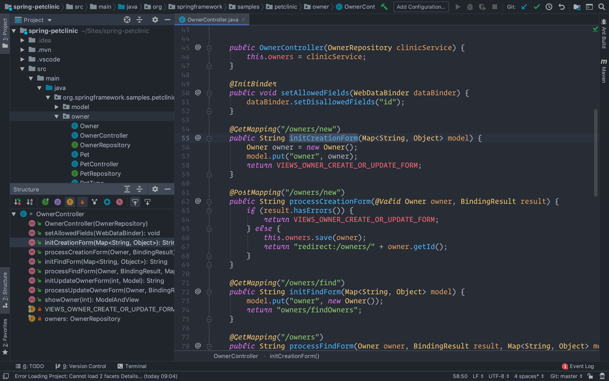

---

## Code quality tools

The four tools complement each other:

| Tool | What it checks | When it runs |
|---|---|---|
| **SonarQube for IDE** | Bugs, vulnerabilities and code smells. Multi-language and broad. | While you type |
| **Checkstyle** | Code **style**: formatting, naming, Javadoc. | While you type and on demand |
| **SpotBugs** | Bug patterns in **compiled bytecode**: nulls, concurrency, resource leaks. Security with Find Security Bugs. | On demand (needs a build first) |
| **PMD** | Patterns in **source code**: unused code, complexity, best practices. | On demand |

### 10. SonarQube for IDE (formerly SonarLint)

**What it does:** Detects bugs, vulnerabilities and code smells **while you type** in Java, Kotlin, JavaScript/TypeScript, Python, HTML, XML and many more languages. Explains why each finding is a problem and how to fix it. Analyzers are bundled (~274 MB).

**Usage:**
* Works automatically. Problematic code is underlined; `Alt+Enter` shows the explanation and quick fixes.
* **View › Tool Windows › SonarQube for IDE** → **Current File** / **Report** tabs
* To scan the whole project: right click → **SonarQube for IDE › Analyze with SonarQube for IDE**
* Settings and rule toggles: **Settings › Tools › SonarQube for IDE**
* Offline, do not set up **Connected Mode** (SonarQube Server/Cloud connection); standalone mode works fully. If there is an internal SonarQube Server, you can connect to it.

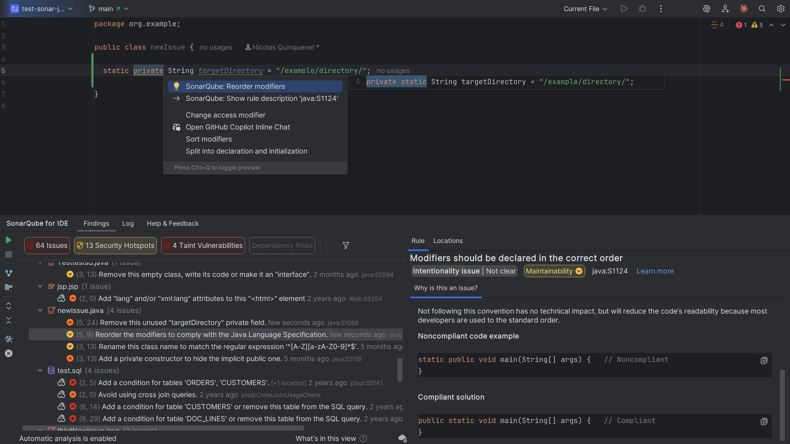
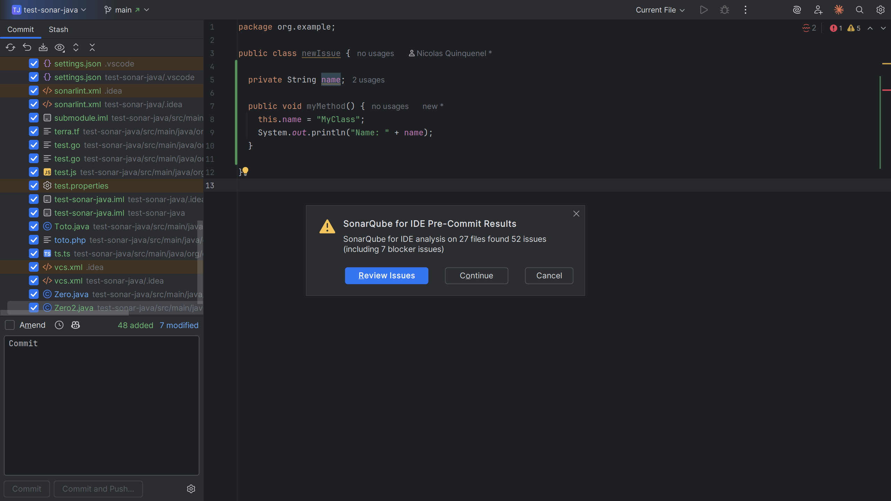

### 11. CheckStyle-IDEA

**What it does:** Checks code against Checkstyle rules: indentation, line length, naming, Javadoc requirements, import order. Problems are marked in the editor as you type. **Checkstyle 14.4.0 is bundled.**

**Usage:**
1. **Settings › Tools › Checkstyle**
   * **Checkstyle version:** choose `14.4.0`. Other versions are downloaded on first use and do not work offline.
   * **Configuration File:** the built-in *Sun Checks* / *Google Checks*, or add a local `checkstyle.xml` with **+** and make it active.
2. **View › Tool Windows › CheckStyle** → **Check Current File**, **Check Module**, **Check Project**, **Check All Modified Files**
3. The commit dialog has a "Scan with Checkstyle" option to scan before committing.

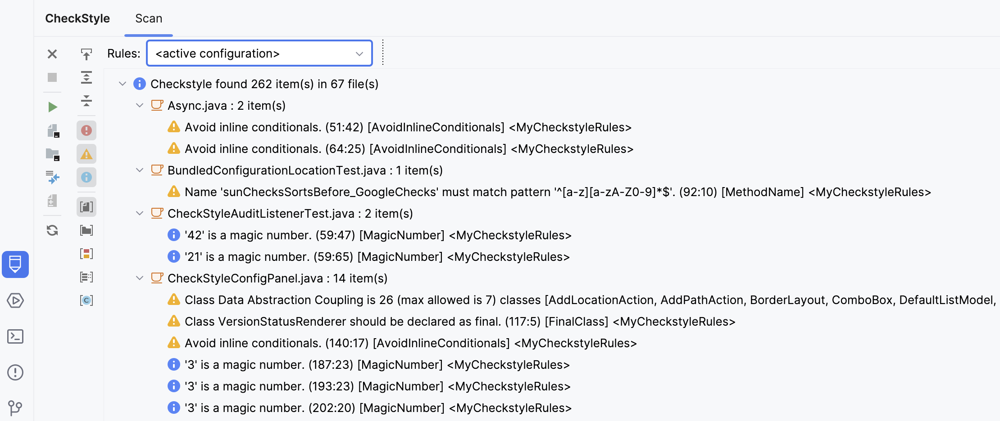
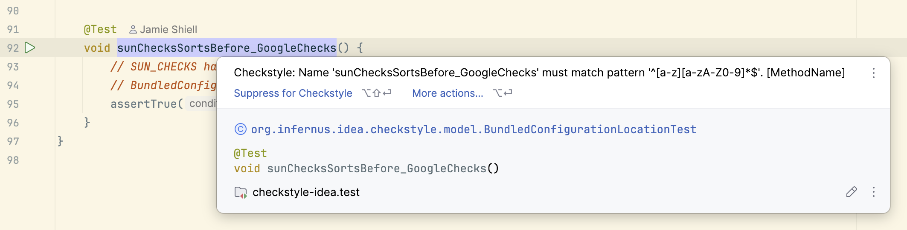

### 22. SpotBugs (spotbugs-idea) + rule jars

**What it does:** SpotBugs, the successor of FindBugs, analyzes compiled Java classes and finds likely bugs: null pointer dereferences, `equals`/`hashCode` mismatches, unclosed streams, synchronization mistakes and more. The plugin bundles the **SpotBugs 4.8.6** engine.

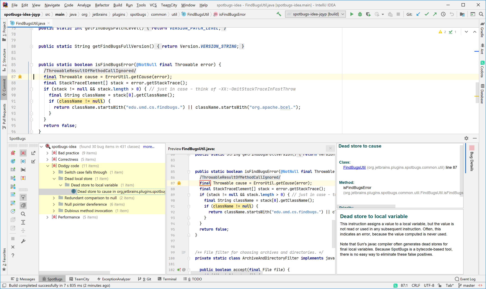

**Usage:**
1. Build the project first (**Build › Build Project**, `Ctrl+F9`). SpotBugs analyzes `.class` files.
2. Right click in the project tree or editor → **SpotBugs** menu:
   * **Analyze Selected Files**
   * **Analyze Class Under Cursor**
   * **Analyze Module Files (Not) Including Test Sources**
   * **Analyze Project Files (Not) Including Test Sources**
   * **Analyze All Modified Files**
3. Results appear in the **SpotBugs** tool window, grouped by category, priority or package. Double click a finding to jump to the code.

**Extra rule sets (rule jars):**

Two popular rule packs extend SpotBugs' own rules:

* **Find Security Bugs** (`findsecbugs-plugin`): 140+ security rules. SQL/LDAP/XPath/command injection, XSS, weak cryptography, hard-coded passwords, insecure random numbers, XXE, path traversal, Spring/JAX-RS/servlet issues.
* **sb-contrib** (formerly fb-contrib): hundreds of extra rules. Performance, API misuse, unnecessary object creation, collection mistakes.

> The plugin already ships older versions (findsecbugs 1.12.0, fb-contrib 7.6.0). Adding the **newer** versions from `spotbugs-rules/` is recommended.

**Adding the rule jars to the IDE:**

1. The graphical installer copies them to `~/.local/share/JetBrains/spotbugs-rules/`. Otherwise copy the folder to a permanent location yourself.
2. **Settings › Tools › SpotBugs** → **Plugins** tab
3. **+ (Install Plugin)** → from `spotbugs-rules/spotbugs-4.8/` select:
   * `findsecbugs-plugin-1.14.0.jar`
   * `sb-contrib-7.6.9.jar`
4. Enable the added rule sets and **disable** the older bundled ones (fb-contrib 6.2.1 / 7.6.0, findsecbugs 1.12.0). Do not keep two versions of the same rule set enabled.
5. Turn off unwanted detectors in the **Detector** tab. Set minimum priority and categories in the **Report** tab.

> ⚠️ **Version compatibility:** the IDE plugin uses SpotBugs **4.8.6**. `sb-contrib 7.7.x` is built for SpotBugs 4.9 and is likely to fail in the IDE. Use the **`spotbugs-4.8/`** folder for the IDE.

**Using the same rules in a Maven build** (`spotbugs-4.9/`): `spotbugs-maven-plugin` 4.9.x uses SpotBugs 4.9. Reference the rule jars available in your internal Nexus or local `~/.m2`:

```xml
<plugin>
  <groupId>com.github.spotbugs</groupId>
  <artifactId>spotbugs-maven-plugin</artifactId>
  <version>4.9.8.5</version>   <!-- uses SpotBugs 4.9.8; must be in your local repository -->
  <configuration>
    <plugins>
      <plugin>
        <groupId>com.h3xstream.findsecbugs</groupId>
        <artifactId>findsecbugs-plugin</artifactId>
        <version>1.14.0</version>
      </plugin>
      <plugin>
        <groupId>com.mebigfatguy.sb-contrib</groupId>
        <artifactId>sb-contrib</artifactId>
        <version>7.7.4</version>
      </plugin>
    </plugins>
  </configuration>
</plugin>
```

To install the jars into the local `~/.m2` repository manually (if Maven is installed):

```bash
mvn install:install-file -Dfile=spotbugs-rules/spotbugs-4.9/findsecbugs-plugin-1.14.0.jar \
    -DgroupId=com.h3xstream.findsecbugs -DartifactId=findsecbugs-plugin -Dversion=1.14.0 -Dpackaging=jar
mvn install:install-file -Dfile=spotbugs-rules/spotbugs-4.9/sb-contrib-7.7.4.jar \
    -DgroupId=com.mebigfatguy.sb-contrib -DartifactId=sb-contrib -Dversion=7.7.4 -Dpackaging=jar
```

### 23. PMD

**What it does:** PMD scans source code (no build needed) against rule sets. It finds unused variables, imports and private methods, empty `catch` blocks, unnecessary complexity, copy-paste patterns and best practice violations. The plugin bundles the **PMD 7.21.0** engine with Java and Kotlin rules.

There is no screenshot on the Marketplace. The image below is an **illustration** of the results window:

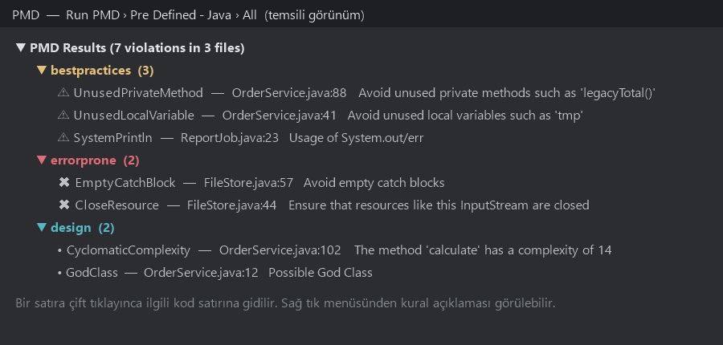

**Usage:**
1. Right click a file, package or module in the project tree → **Run PMD** →
   * **Pre Defined - Java** → `All` or a category (*bestpractices, codestyle, design, documentation, errorprone, multithreading, performance, security*)
   * **Pre Defined - Kotlin**
   * **Custom Rule** → your own ruleset XML
2. Results appear in the **PMD** tool window grouped by rule. Double click to jump to the line.
3. To add your own rule set: **Settings › Tools › PMD** → **RuleSets** tab → **+** → local XML file. Offline, reference rules by classpath (e.g. `category/java/bestpractices.xml`) or local file path instead of URLs.
4. The **Options** tab sets the target Java version and options such as "Skip test sources".

Minimal example ruleset (`pmd-rules.xml`):

```xml
<?xml version="1.0"?>
<ruleset name="Project Rules"
         xmlns="http://pmd.sourceforge.net/ruleset/2.0.0"
         xmlns:xsi="http://www.w3.org/2001/XMLSchema-instance"
         xsi:schemaLocation="http://pmd.sourceforge.net/ruleset/2.0.0 https://pmd.sourceforge.io/ruleset_2_0_0.xsd">
  <description>Team rules</description>
  <rule ref="category/java/bestpractices.xml"/>
  <rule ref="category/java/errorprone.xml"/>
  <rule ref="category/java/security.xml"/>
  <rule ref="category/java/design.xml">
    <exclude name="LawOfDemeter"/>
  </rule>
</ruleset>
```

> The URL in `xsi:schemaLocation` is informational only. PMD does not connect to it; the ruleset works offline.

---

## Optional plugins

The plugins in `plugins/optional/` were selected, but they **do not work in a fully offline environment** or need extra components. The scripts install them only with `--optional` / `-Optional` (and only the Copilot package for the current OS); the graphical installer shows them only when the corresponding checkbox is ticked.

### GitHub Copilot (Linux x64 / Windows x64)

**What it does:** AI-assisted code completion and chat.
**Requirements:** a GitHub account with a Copilot subscription and **internet access** to GitHub's servers. It does not work fully offline. Two packages are included, `…-linux-x64.zip` and `…-windows-x64.zip`; the installer and the scripts pick the one for your OS.
**Usage:** after installing, click the Copilot icon in the bottom right → **Login to GitHub**.

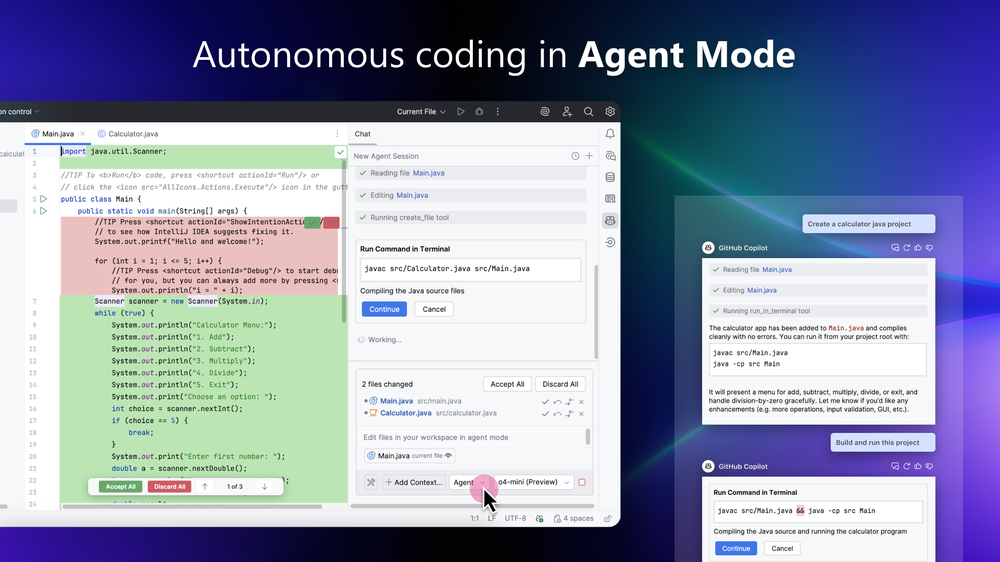
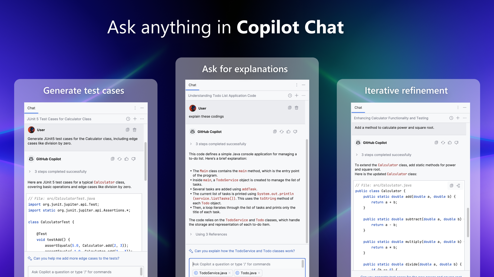

### Claude Code [Beta]

**What it does:** Connects Anthropic's Claude Code command line tool to the IDE: shows diffs in the IDE's diff viewer and shares the selected code and diagnostics with Claude.
**Requirements:** the `claude` CLI must be installed, with network access to the Anthropic API (or an internally routed endpoint).
**Usage:** run `claude` in the IDE's terminal; the plugin connects automatically.

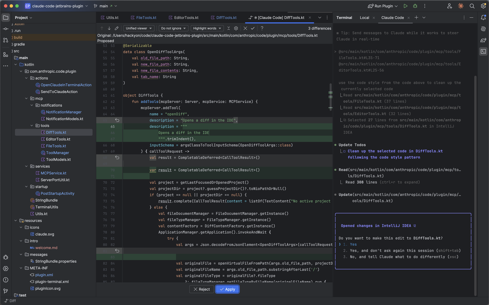
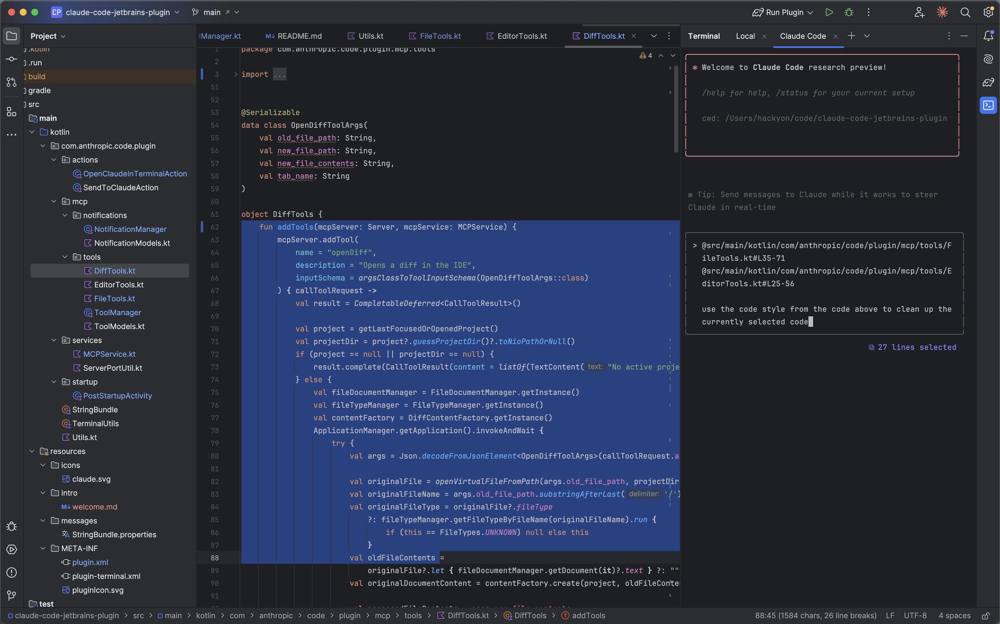

### Line Profiler

**What it does:** Profiles Python code line by line and shows each line's time in the editor with colors.
**Requirements:** the **Python plugin** (`com.intellij.modules.python`) in the IDE and the `line_profiler` Python package in the project. Without the Python plugin, this plugin does not load.

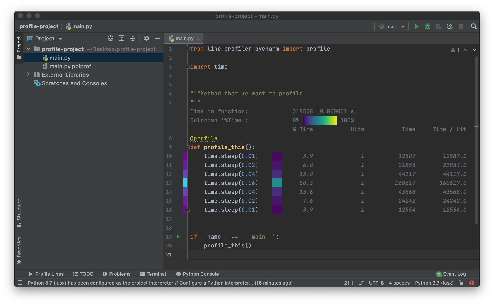
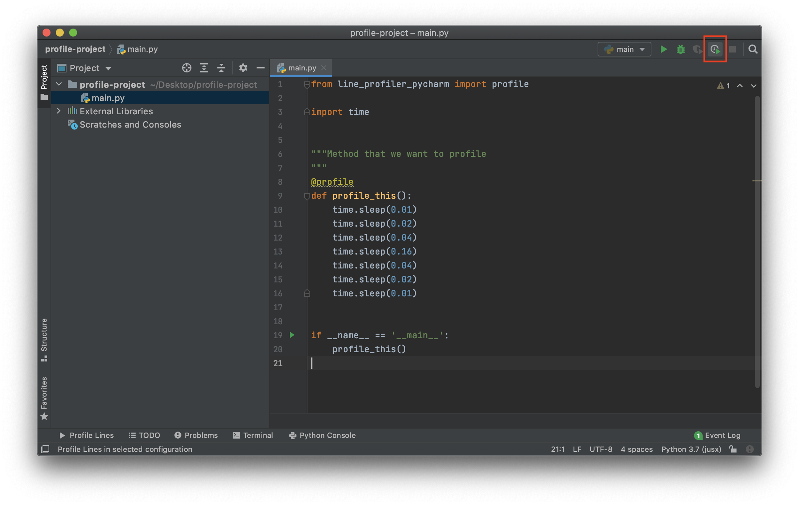

---

## Customizing the installer

* To change plugin descriptions, images or the recommended flag, edit `catalog.json`. No rebuild is needed. Every text has an `en` and a `tr` version.
* If you changed the program itself (requires JDK 11+):

```bash
javac --release 11 -encoding UTF-8 -d build src/PluginInstaller.java
jar --create --file plugin-installer.jar --main-class PluginInstaller -C build .
```

* Check without a GUI: `java -jar plugin-installer.jar --test --root .` verifies all package files and images and lists the installed status of each plugin.
* README screenshots: `java -jar plugin-installer.jar --root . --lang en --snapshot docs/images/installer --select pmd,dbn --show dbn` renders the window to `installer-main.png` and `installer-preview.png` without showing it on screen.

---

## Troubleshooting

| Problem | Solution |
|---|---|
| Windows: `plugin-installer.cmd` says IntelliJ IDEA could not be found | Pass the installation directory: `.\plugin-installer.cmd -IdeaHome "C:\…\IntelliJ IDEA 2026.2"` (the directory containing `jbr\` and `product-info.json`). |
| Windows: "running scripts is disabled on this system" | Start the `.cmd` files instead of the `.ps1` files; they run PowerShell with `-ExecutionPolicy Bypass` for that one script only. |
| Windows: `install-plugins.cmd` fails with a path error | The target path is too long for PowerShell 5.1 (260 characters). Use a shorter `-Target` or the graphical installer. |
| `plugin-installer.sh`: "Java 11+ not found" | Pass the IDEA installation directory: `./plugin-installer.sh --idea-home /opt/idea-…` (the directory containing `jbr/` and `product-info.json`). |
| Installer text is too small (HiDPI screen) | `GDK_SCALE=2 ./plugin-installer.sh` |
| "Plugin X is incompatible with this installation" | Plugins may not load if your IDE is older than 2026.2. Check the build number in **Help › About** (it must be 262.x or later). |
| "Plugin requires plugin Y to be installed" | The required IDE component (e.g. Maven, YAML, Markdown) may be disabled under **Settings › Plugins › Installed**; enable it. |
| "Fail to load plugin descriptor" after selecting a zip | Select **the zip file itself**, not its extracted contents. |
| Plugin not visible after installing | Restart the IDE. If you used the script, make sure the `--target` directory is correct. You can find the right directory as the `plugins` path in `idea.log` (**Help › Show Log in Files**). |
| SpotBugs "No classes found to analyze" | Build the project first (`Ctrl+F9`). |
| Error after adding a SpotBugs rule jar | Use the jars from **`spotbugs-4.8/`**, not `spotbugs-4.9/`. |
| Checkstyle "Could not download Checkstyle version" | **Settings › Tools › Checkstyle** → select the bundled version **14.4.0**. |
| PlantUML "Cannot find Graphviz" | Install the `graphviz` package or add `!pragma layout smetana` to the diagram. |

---

*Prepared on 2026-11-24; Windows support, English UI and version ranges added on 2026-11-25 · Sources: JetBrains Marketplace (build IU-262) and Maven Central*
