# IntelliJ IDEA Çevrimdışı Eklenti Paketi (Linux ve Windows)

**Dil / Language:** [English](README.md) | **Türkçe**

Bu klasör, **IntelliJ IDEA (ücretsiz sürüm, Ultimate aboneliği olmadan)** için seçilmiş eklentileri içerir. Eklentiler **internetsiz bir Linux veya Windows makinesine diskten elle kurulmak** üzere hazırlandı.

* **Uyumluluk:** her eklentinin kendi en düşük IntelliJ IDEA sürümü var ([eklenti listesindeki](#eklenti-listesi) *IntelliJ IDEA* sütunu). Desteklenen en eski sürüm **2021.3** (GenerateAllSetter). **Paketin tamamı 2026.2 ve üzerini ister**, çünkü Atom Material Icons 2026.2 gerektiriyor. 2026.1'de Atom Material Icons dışındaki her şey çalışır. Grafik kurulum programı IDEA sürümünüzü algılar ve yalnızca uyumlu eklentileri seçtirir.
* Tüm eklentiler JetBrains Marketplace'ten **IU-262 (2026.2)** için en yeni sürümleriyle indirildi. Eklentiler platformdan bağımsızdır; yalnızca GitHub Copilot'un ayrı **Linux x64** ve **Windows x64** paketleri var (ikisi de dahil).
* Her eklentinin bağımlılıkları kontrol edildi. Zorunlu bağımlılıkların hepsi IntelliJ IDEA'nın kendi bileşenleri (Java, Maven, YAML, Markdown, Git…), dolayısıyla ek indirme gerekmez.
* SpotBugs kural jar'ları Maven Central'dan indirildi ve SHA-1 doğrulaması yapıldı.

---

## İçindekiler

1. [Klasör yapısı](#klasör-yapısı)
2. [Kurulum](#kurulum)
3. [Çevrimdışı kullanım için önerilen ayarlar](#çevrimdışı-kullanım-için-önerilen-ayarlar)
4. [Eklenti listesi](#eklenti-listesi)
5. [Eklentilerin tanıtımı ve kullanımı](#eklentilerin-tanıtımı-ve-kullanımı)
6. [Kod kalitesi: SpotBugs, PMD, Checkstyle, SonarQube](#kod-kalitesi-araçları)
7. [Opsiyonel eklentiler (internet veya ek bileşen ister)](#opsiyonel-eklentiler)
8. [Sorun giderme](#sorun-giderme)

---

## Klasör yapısı

```
.
├── README.md                     ← İngilizce sürüm (varsayılan)
├── README.tr.md                  ← bu dosya (Türkçe)
├── plugin-installer.sh           ← GRAFİK KURULUM ARAYÜZÜ, Linux (önerilen)
├── plugin-installer.cmd          ← GRAFİK KURULUM ARAYÜZÜ, Windows (çift tıklayın)
├── plugin-installer.ps1          ←   (plugin-installer.cmd tarafından kullanılır)
├── plugin-installer.jar          ← arayüz programı (IDEA'nın kendi Java'sıyla çalışır)
├── catalog.json                  ← arayüzde görünen eklenti bilgileri, EN + TR (düzenlenebilir)
├── src/PluginInstaller.java      ← arayüzün kaynak kodu
├── install-plugins.sh            ← arayüzsüz toplu kurulum betiği, Linux
├── install-plugins.cmd           ← arayüzsüz toplu kurulum betiği, Windows
├── install-plugins.ps1           ←   (install-plugins.cmd tarafından kullanılır)
├── SHA256SUMS.txt                ← dosya bütünlüğü kontrolü (parçalar dahil, dosyaların diskteki hali)
├── plugins/                      ← kurulacak eklentiler (.zip, AÇMAYIN)
│   ├── *.zip.001, *.zip.002 …    ← parçalara bölünmüş büyük eklentiler (aşağıya bakın)
│   ├── *.zip.sha256              ← birleştirilmiş zip'in sağlaması
│   └── optional/                ← internet / ek bileşen isteyen eklentiler
├── spotbugs-rules/
│   ├── spotbugs-4.8/             ← IDE'deki SpotBugs eklentisi için (bunu kullanın)
│   └── spotbugs-4.9/             ← Maven/Gradle derlemelerindeki SpotBugs 4.9.x için
└── docs/images/                  ← README ekran görüntüleri
```

---

## Kurulum

Klasörün tamamını (USB, ağ paylaşımı vb. ile) hedef makineye kopyalayın. Kopyalama sırasında bozulma olmadığını doğrulamak için:

```bash
# Linux
sha256sum -c SHA256SUMS.txt
```

```powershell
# Windows (PowerShell, klasörün içinde çalıştırın)
Get-Content SHA256SUMS.txt | ForEach-Object { $h, $f = $_ -split '\s+\*?', 2; if ((Get-FileHash $f -Algorithm SHA256).Hash -ne $h) { "UYUSMUYOR $f" } }; "kontrol bitti"
```

### Yöntem 1: Grafik kurulum arayüzü (önerilen)

Hangi eklentilerin kurulacağını kendiniz seçtiğiniz bir masaüstü programı. **Python veya ayrı bir Java kurulumu gerekmez.** Program IntelliJ IDEA'nın kendi içindeki Java'yı (`<IDEA>/jbr/`) bulup kullanır. **Hiçbir koşulda internete bağlanmaz**, tüm bilgileri bu klasörden okur.

**Linux:**

```bash
cd /yol/Intellij-IDEA-Plugins
chmod +x plugin-installer.sh
./plugin-installer.sh
```

IDEA standart olmayan bir yere kurulduysa veya bulunamazsa kurulum dizinini verin:

```bash
./plugin-installer.sh --idea-home /opt/idea-IU-262.xxxx
```

**Windows:** **`plugin-installer.cmd`** dosyasına çift tıklayın. IntelliJ IDEA'yı `C:\Program Files\JetBrains\`, `%LOCALAPPDATA%\Programs\`, JetBrains Toolbox ve kayıt defterindeki kurulu programlar listesinde arar, en yeni IntelliJ IDEA'yı seçer. Bulamazsa dizini verin:

```powershell
.\plugin-installer.cmd -IdeaHome "C:\Program Files\JetBrains\IntelliJ IDEA 2026.2"
```

Pencere varsayılan olarak **İngilizce** açılır. Sağ üstteki dil kutusundan **Türkçe**'ye geçebilirsiniz; seçim hatırlanır.

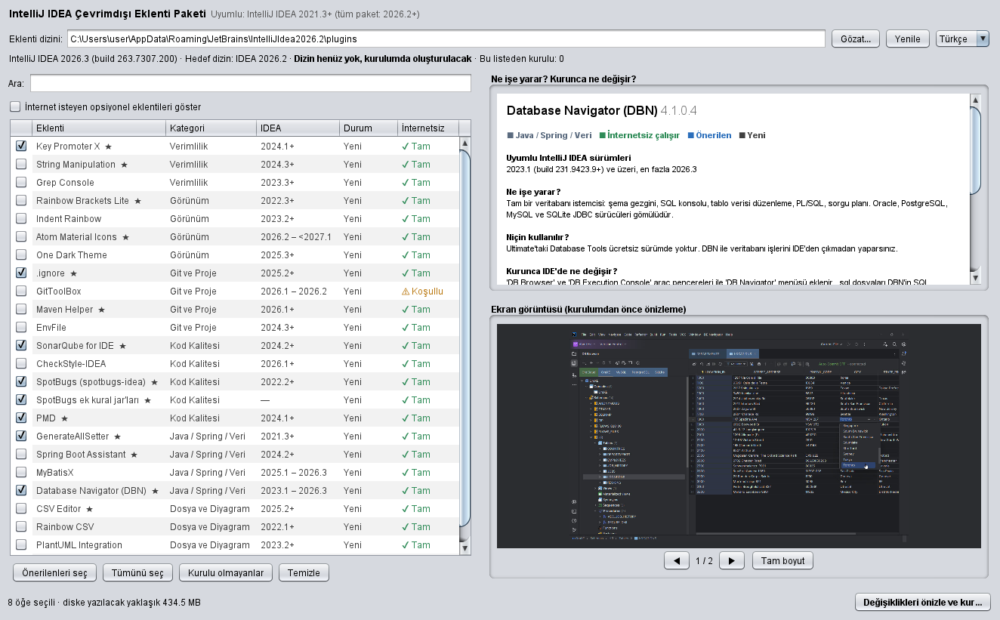

**Arayüzde neler var?**

* **Başlık:** paketin desteklediği IntelliJ IDEA sürümlerini gösterir (2021.3+, tüm paket 2026.2+).
* **Eklenti dizini:** IDEA'nın `product-info.json` dosyasından otomatik bulunur (Linux: `~/.local/share/JetBrains/IntelliJIdea2026.2`, Windows: `%APPDATA%\JetBrains\IntelliJIdea2026.2\plugins`). `idea.properties` içinde `idea.plugins.path` tanımlıysa o kullanılır. **Gözat…** ile değiştirilebilir.
* **Liste:** Kategori, her eklentinin desteklediği **IntelliJ IDEA sürümleri**, **Durum** (*Yeni* / *Kurulu* / *Güncellenecek* / *Uyumsuz*) ve **İnternetsiz** çalışma bilgisi. Hedef dizinin IDEA sürümünü desteklemeyen eklentiler *Uyumsuz* görünür ve seçilemez. ★ önerilen eklentileri gösterir. Arama kutusu ad ve açıklamalarda arar.
* **Seçim düğmeleri:** *Önerilenleri seç*, *Tümünü seç*, *Kurulu olmayanlar* (yalnızca yeni veya güncellenecek olanlar), *Temizle*.
* **Ayrıntı paneli:** Ne işe yaradığı, niçin kullanıldığı, **kurunca IDE'de neyin değişeceği**, nasıl kullanıldığı, gereksinimler ve uyarılar, kurulacağı klasör ve kurulu sürüm.
* **Ekran görüntüsü paneli:** Kurmadan önce eklentinin nasıl göründüğünü gösterir. GIF'ler animasyonlu oynar. **◀ ▶** ile görseller arasında geçilir, **Tam boyut** veya görsele tıklama ile büyütülür.
* **İnternet isteyen opsiyonel eklentiler** (Copilot, Claude Code, Line Profiler) varsayılan olarak gizlidir. Kutucuk işaretlenince listelenir. Copilot'un yalnızca çalışılan işletim sistemine uygun paketi gösterilir.
* **SpotBugs ek kural jar'ları** seçilince, SpotBugs kurulu değilse o da otomatik seçilir.

**Değişiklikleri önizle ve kur…** düğmesi kurmadan önce yapılacak her şeyi listeler: yeni kurulum, güncelleme (eski → yeni sürüm) veya yeniden kurulum, hangi klasöre yazılacağı, IDE'de neyin değişeceği, diske yazılacak boyut. Ayrıca şu uyarıları verir: IDE açık, disk dolu, internet isteyen eklenti, bağımlılık eksik.

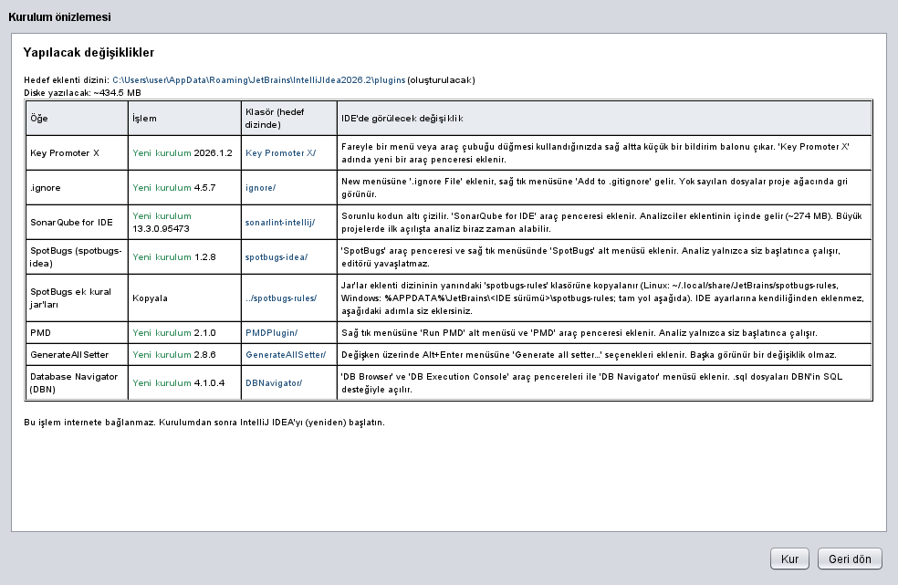

* Güncellenen veya yeniden kurulan eklentinin **eski klasörü silinmez**, eklenti dizininin yanındaki `plugin-backups/<tarih-saat>/` altına taşınır (Linux: `~/.local/share/JetBrains/plugin-backups/`, Windows: `%APPDATA%\JetBrains\IntelliJIdea2026.2\plugin-backups\`). Geri almak için klasörü eski yerine taşımanız yeterli.
* SpotBugs kural jar'ları eklenti dizininin yanındaki `spotbugs-rules/` klasörüne kopyalanır (Linux: `~/.local/share/JetBrains/spotbugs-rules/`, Windows: `%APPDATA%\JetBrains\IntelliJIdea2026.2\spotbugs-rules\`). Kurulum sonunda bunları SpotBugs ayarlarına nasıl ekleyeceğiniz gösterilir.
* Kurulumdan sonra IntelliJ IDEA'yı (yeniden) başlatın.

> Linux'ta arayüz grafik oturum ister (`DISPLAY` / Wayland). SSH ile bağlanılan, ekranı olmayan bir sunucuda **Yöntem 3** (`install-plugins.sh`) kullanın.
>
> Ekran görüntüleri Windows üzerinde IntelliJ IDEA'nın kendi Java'sıyla (JBR 25), `--snapshot` seçeneğiyle oluşturuldu. Linux'ta görünüm aynıdır, yalnızca pencere çerçevesi ve yazı tipleri dağıtıma göre değişir.

### Yöntem 2: IDE arayüzünden (tek tek)

1. IntelliJ IDEA'yı açın → **File › Settings** (`Ctrl+Alt+S`) → **Plugins**.
2. Sağ üstteki **⚙ (dişli)** simgesi → **Install Plugin from Disk…**
3. `plugins/` altındaki **.zip dosyasını** seçin. Zip'i açmayın, olduğu gibi verin.
4. Her eklenti için tekrarlayın, sonra **Restart IDE** deyin.

**Parçalara bölünmüş eklentiler** (`*.zip.001`, `*.zip.002` …) önce birleştirilmelidir. Kurulum programı ve betikler bunu kendiliğinden yapar:

```bash
# Linux
cat plugins/sonarlint-intellij-13.3.0.95473.zip.0* > /tmp/sonarlint-intellij-13.3.0.95473.zip
```

```powershell
# Windows
cmd /c copy /b plugins\sonarlint-intellij-13.3.0.95473.zip.001+plugins\sonarlint-intellij-13.3.0.95473.zip.002+plugins\sonarlint-intellij-13.3.0.95473.zip.003 %TEMP%\sonarlint-intellij-13.3.0.95473.zip
```

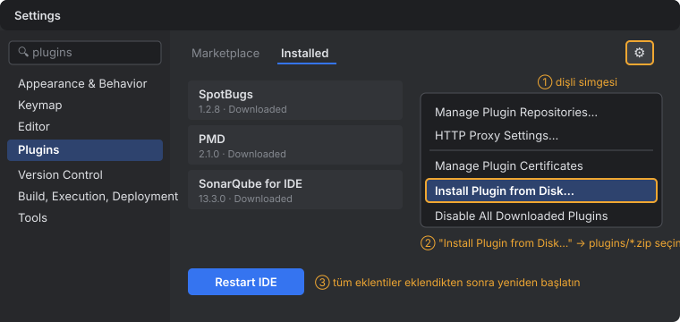

### Parçalara bölünmüş dosyalar

GitHub 100 MB'tan büyük dosyaları kabul etmediği için en büyük üç eklenti 95 MB'lık parçalar halinde duruyor:

| Eklenti | Parçalar |
|---|---|
| SonarQube for IDE | `sonarlint-intellij-13.3.0.95473.zip.001` – `.003` |
| GitHub Copilot (Linux x64) | `github-copilot-intellij-1.21.1-261-linux-x64.zip.001` – `.003` |
| GitHub Copilot (Windows x64) | `github-copilot-intellij-1.21.1-261-windows-x64.zip.001` – `.002` |

Grafik kurulum programı ve iki betik parçaları geçici bir dosyada birleştirir, `.zip.sha256` dosyasıyla doğrular ve sonra kurar. Hiçbir şey indirilmez. Tüm parçaları aynı klasörde tutun.

### Yöntem 3: Betikle toplu kurulum (arayüzsüz)

IDE **kapalıyken** çalıştırın:

```bash
cd /yol/Intellij-IDEA-Plugins
chmod +x install-plugins.sh
./install-plugins.sh                 # plugins/ altındaki tüm eklentiler
./install-plugins.sh --optional     # + plugins/optional/ altındakiler
./install-plugins.sh --target ~/.local/share/JetBrains/IntelliJIdea2026.3   # farklı sürüm/dizin
```

Betik zip'leri IntelliJ'in eklenti dizinine açar. `--target` verilmezse mevcut en yeni `~/.local/share/JetBrains/IntelliJIdea<sürüm>` (veya `IdeaIC<sürüm>`) dizinini kullanır. Aynı eklentinin eski sürümü varsa önce onu siler. Betik sürüm uyumluluğunu denetlemez; uyumsuz bir eklentiyi IntelliJ IDEA açılışta kendisi devre dışı bırakır.

**Windows:** IDE kapalıyken **`install-plugins.cmd`** çalıştırın:

```powershell
.\install-plugins.cmd                      # plugins\ altındaki tüm eklentiler
.\install-plugins.cmd -Optional            # + plugins\optional\ (yalnızca Windows Copilot)
.\install-plugins.cmd -Target "$env:APPDATA\JetBrains\IntelliJIdea2026.3\plugins"
```

`-Target` verilmezse mevcut en yeni `%APPDATA%\JetBrains\IntelliJIdea<sürüm>\plugins` dizini kullanılır. Windows PowerShell 5.1, 260 karakterden uzun yollara yazamaz. Varsayılan hedefte sorun olmaz; derin bir `-Target` seçip açma hatası alırsanız daha kısa bir yol veya grafik kurulum programını kullanın (onda bu sınır yok).

> **Not:** IDEA 2026.3 gibi daha yeni bir sürüm kullanıyorsanız dizin adı da değişir; `--target` ile verin. Eklentilerin çoğu "since-build" sınırıyla tanımlı, yani yeni sürümlerde de yüklenir. Sürüm üst sınırı olanlar şunlar: **Atom Material Icons** (≤ 271), **MyBatisX** ve **Database Navigator** (≤ 263.\*), **GitToolBox** (≤ 262.\*). IDE yükseltildiğinde bunların yeni sürümlerini indirmeniz gerekebilir.

---

## Çevrimdışı kullanım için önerilen ayarlar

İnternet yokken IDE'nin sürekli bağlanmaya çalışıp uyarı vermesini engellemek için:

| Ayar | Yol |
|---|---|
| IDE ve eklenti güncelleme kontrolünü kapatın | **Settings › Appearance & Behavior › System Settings › Updates** → "Check IDE updates" ve "Check for plugin updates" işaretlerini kaldırın |
| Proxy yoksa "No proxy" seçin | **Settings › Appearance & Behavior › System Settings › HTTP Proxy** |
| GitToolBox otomatik fetch'i kapatın (uzak git sunucusu yoksa) | **Settings › Version Control › GitToolBox** → Auto Fetch |
| SonarQube'u "Connected Mode" olmadan kullanın | Sunucu bağlantısı tanımlamayın; varsayılan tek başına mod internetsiz çalışır |
| Checkstyle'da gömülü sürümü seçin | **Settings › Tools › Checkstyle** → Checkstyle version: **14.4.0** (eklentiyle gelen sürüm; diğer sürümler internetten indirilir) |

---

## Eklenti listesi

| # | Eklenti | Sürüm | IntelliJ IDEA | Dosya | Çevrimdışı |
|---|---|---|---|---|---|
| 1 | Key Promoter X | 2026.1.2 | 2024.1+ | `Key_Promoter_X-2026.1.2.zip` | ✅ |
| 2 | String Manipulation | 9.16.0 | 2024.3+ | `StringManipulation-9.16.0.zip` | ✅ |
| 3 | Rainbow Brackets Lite | 1.3.0 | 2022.3+ | `intellij-rainbow-brackets-lite-1.3.0.zip` | ✅ |
| 4 | Indent Rainbow | 2.2.0 | 2023.2+ | `Indent_Rainbow-2.2.0-signed.zip` | ✅ |
| 5 | Grep Console | 13.3.0 | 2023.3+ | `GrepConsole-13.3.0-IJ2023.3.zip` | ✅ |
| 6 | .ignore | 4.5.7 | 2025.2+ | `ignore-4.5.7.zip` | ✅ |
| 7 | GitToolBox | 600.3.6 | 2026.1 – 2026.2 (build 261.23567+) | `gittoolbox-600.3.6_261-signed.zip` | ⚠️ ücretli özellikler lisans kontrolü ister |
| 8 | Maven Helper | 5.1.0 | 2026.1+ | `MavenHelper-5.1.0-IJ2026.1.zip` | ✅ (bağımlılıklar yerel depoda olmalı) |
| 9 | EnvFile | 5.0.1 | 2024.3+ | `EnvFile-5.0.1.zip` | ✅ |
| 10 | SonarQube for IDE | 13.3.0 | 2024.2+ (build 242.20224.300+) | `sonarlint-intellij-13.3.0.95473.zip` (3 parça: `.001`–`.003`) | ✅ (tek başına mod) |
| 11 | CheckStyle-IDEA | 26.20.0 | 2026.1+ | `checkstyle-idea-26.20.0.zip` | ✅ (gömülü Checkstyle 14.4.0) |
| 12 | GenerateAllSetter | 2.8.6 | 2021.3+ | `GenerateAllSetter-2.8.6.zip` | ✅ |
| 13 | Spring Boot Assistant | 601.0.7 | 2024.2+ | `spring-boot-assistant-601.0.7_242.zip` | ✅ |
| 14 | MyBatisX | 1.7.9 | 2025.1 – 2026.3 | `MybatisX-1.7.9.zip` | ✅ |
| 15 | Database Navigator (DBN) | 4.1.0.4 | 2023.1 – 2026.3 (build 231.9423.9+) | `DBN-4.1.0.4.zip` | ✅ (JDBC sürücüleri gömülü) |
| 16 | CSV Editor | 252.56.1 | 2025.2+ | `intellij-csv-validator-252.56.1.zip` | ✅ |
| 17 | Rainbow CSV | 2.0.2 | 2022.1+ | `RainbowCSV.zip` | ✅ |
| 18 | PlantUML Integration | 7.15.0 | 2023.2+ (build 232.6734+) | `plantuml4idea-7.15.0-IJ2023.2.zip` | ✅ (bazı diyagramlar Graphviz ister) |
| 19 | Mermaid Visualizer | 1.14.0 | 2025.3+ | `MermaidVisualizer-1.14.0.zip` | ✅ (mermaid.js gömülü) |
| 20 | Atom Material Icons | 210.0.2 | 2026.2 – 2027.1 öncesi | `Atom_Material_Icons-210.0.2.zip` | ✅ |
| 21 | One Dark Theme | 6.2.5 | 2025.3+ | `one-dark-theme-6.2.5.zip` | ✅ |
| 22 | **SpotBugs (spotbugs-idea)** | 1.2.8 | 2022.2+ (build 222.1+) | `spotbugs-idea-1.2.8.zip` | ✅ |
| 23 | **PMD** | 2.1.0 | 2024.1+ | `PMDPlugin-2.1.0.zip` | ✅ (PMD 7.21.0 gömülü) |
| — | GitHub Copilot (Linux x64) | 1.21.1 | 2026.1+ | `optional/github-copilot-intellij-1.21.1-261-linux-x64.zip` (3 parça: `.001`–`.003`) | ❌ internet şart |
| — | GitHub Copilot (Windows x64) | 1.21.1 | 2026.1+ | `optional/github-copilot-intellij-1.21.1-261-windows-x64.zip` (2 parça: `.001`–`.002`) | ❌ internet şart |
| — | Claude Code [Beta] | 0.1.14-beta | 2024.2+ | `optional/claude-code-jetbrains-plugin-0.1.14-beta.zip` | ❌ CLI ve API erişimi şart |
| — | Line Profiler | 1.10.0 | 2024.2+ | `optional/pycharm-lineprofiler-1.10.0.zip` | ⚠️ Python eklentisi şart |

*IntelliJ IDEA* sütunu, her eklentinin `plugin.xml` dosyasından okunan destek aralığıdır. GitToolBox en az build 261.23567 (bir 2026.1.x güncellemesi), SonarQube en az build 242.20224.300 (bir 2024.2.x güncellemesi) ister.

**SpotBugs ek kural jar'ları:**

| Dosya | Klasör | Uyumlu SpotBugs |
|---|---|---|
| `findsecbugs-plugin-1.14.0.jar` (Find Security Bugs) | `spotbugs-4.8/` ve `spotbugs-4.9/` | 4.8.6 ile derlenmiş, 4.8.x / 4.9.x |
| `sb-contrib-7.6.9.jar` | `spotbugs-4.8/` | 4.8.x (IDE eklentisindeki 4.8.6 için) |
| `sb-contrib-7.7.4.jar` | `spotbugs-4.9/` | 4.9.x (Maven/Gradle derlemeleri için) |

---

## Eklentilerin tanıtımı ve kullanımı

> **Ayar yolları hakkında:** Menü ve ayar yolları IDE veya eklenti sürümüne göre biraz değişebilir. Bulamazsanız **Settings** (`Ctrl+Alt+S`) arama kutusuna eklentinin adını yazın.
>
> Ekran görüntüleri her eklentinin JetBrains Marketplace sayfasından alındı; telif hakları eklenti yazarlarına aittir. Bazı görüntüler eski IDE temalarıyla çekilmiş olabilir, işlevleri aynıdır.

### 1. Key Promoter X

**Ne işe yarar:** Menüden veya fareyle bir işlem yaptığınızda, o işlemin klavye kısayolunu sağ altta bildirim olarak gösterir. Kısayolu olmayan bir işlemi sık kullanıyorsanız kısayol atamayı önerir.

**Kullanım:**
* Kurduktan sonra kendiliğinden çalışır.
* **View › Tool Windows › Key Promoter X** penceresi, en çok fareyle yaptığınız işlemleri istatistik olarak listeler.
* Ayarlar: **Settings › Tools › Key Promoter X**


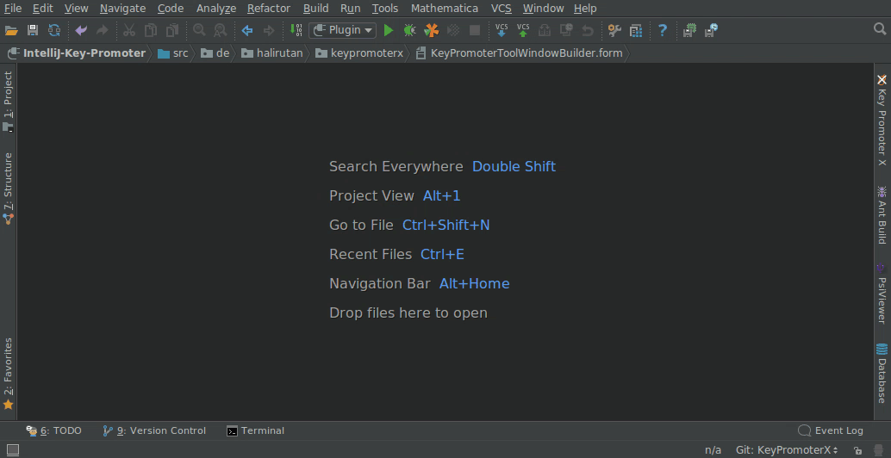

### 2. String Manipulation

**Ne işe yarar:** Seçili metin üzerinde onlarca dönüşüm yapar: camelCase ↔ snake_case ↔ kebab-case ↔ CONSTANT_CASE, büyük/küçük harf, satır sıralama, tekrarları silme, Base64/URL/HTML encode-decode, escape işlemleri, satır içinde sayıları artırma ve benzerleri.

**Kullanım:**
* Metni seçin → `Alt+M` → açılan menüden işlemi seçin.
* Ya da **Edit › String Manipulation** menüsü veya sağ tık menüsü.
* Kısayollar ve ayarlar: **Settings › Other Settings › String Manipulation** (veya arama kutusuna "string manipulation").


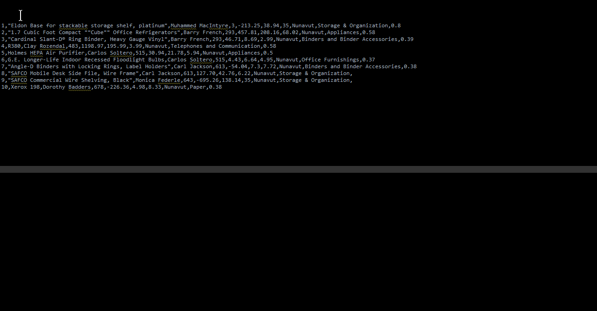

### 3. Rainbow Brackets Lite

**Ne işe yarar:** İç içe parantezleri `() [] {} <>` derinliklerine göre farklı renklerle boyar. Hangi parantezin hangisiyle kapandığını görmeyi kolaylaştırır. Ücretli "Rainbow Brackets" eklentisinin açık kaynak ve ücretsiz sürümüdür.

**Kullanım:** Kendiliğinden çalışır. Renkler: **Settings › Editor › Color Scheme › Rainbow Brackets** (Settings arama kutusuna "rainbow" yazın).

Marketplace'te ekran görüntüsü yok. Aşağıdaki görsel **temsilidir**:

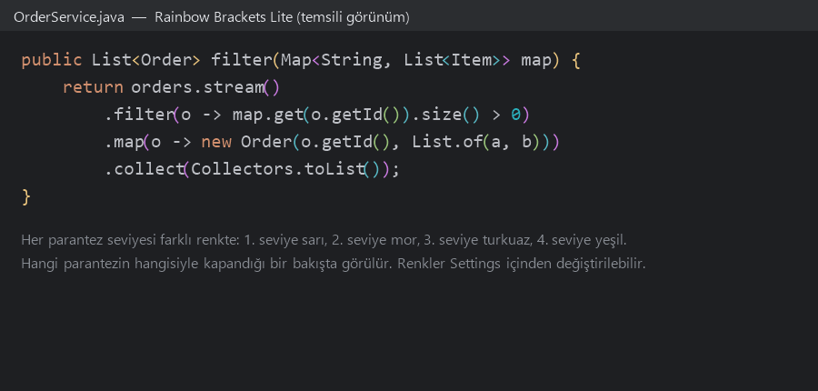

### 4. Indent Rainbow

**Ne işe yarar:** Girinti seviyelerini hafif renkli şeritlerle gösterir. YAML, Python ve iç içe XML gibi girintinin önemli olduğu dosyalarda çok işe yarar. Hatalı girintiyi kırmızıyla işaretler.

**Kullanım:** Kendiliğinden çalışır. Ayarlar: **Settings › Editor › Indent Rainbow** (veya "indent rainbow" araması).

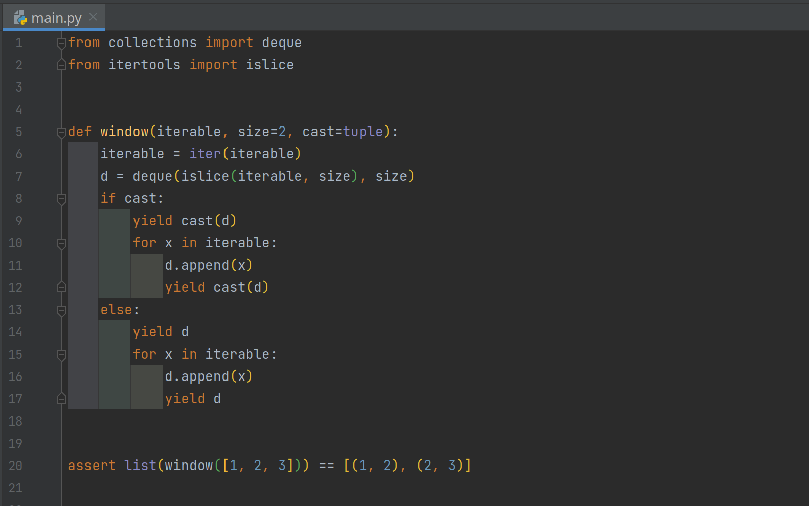

### 5. Grep Console

**Ne işe yarar:** Run/Debug konsolundaki ve log dosyalarındaki satırları, tanımladığınız desenlere göre renklendirir, gizler veya ayrı bir sekmeye süzer. Örneğin `ERROR` satırlarını kırmızı yapabilir, `DEBUG` satırlarını gizleyebilirsiniz.

**Kullanım:**
* Konsolda metin seçin → sağ tık → **Grep** ile filtreli yeni bir konsol sekmesi açılır.
* Konsol araç çubuğundaki Grep Console simgesi veya **Settings › Other Settings › Grep Console** üzerinden kurallar eklenir.
* **Tail File** özelliği ile herhangi bir log dosyasını IDE içinde canlı izleyebilirsiniz (**Tools › Open File in Console** / Tail).

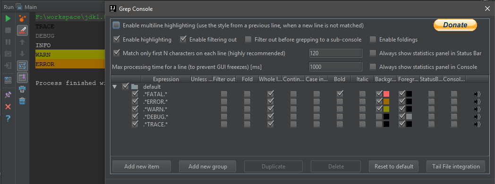

### 6. .ignore

**Ne işe yarar:** `.gitignore`, `.dockerignore`, `.npmignore`, `.helmignore` gibi dosyalara sözdizimi renklendirme ve tamamlama ekler. Hazır şablonlarla (Java, Maven, IntelliJ, Node…) `.gitignore` üretir. Şablonlar eklentinin içinde gelir, internet gerekmez.

**Kullanım:**
* Proje ağacında sağ tık → **New › .ignore File › .gitignore File (Git)** → şablonları seçin.
* Bir dosyaya sağ tık → **Add to .gitignore**
* Yok sayılan dosyalar proje ağacında gri görünür.

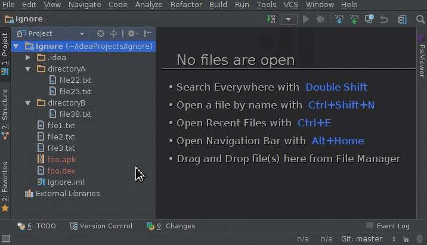
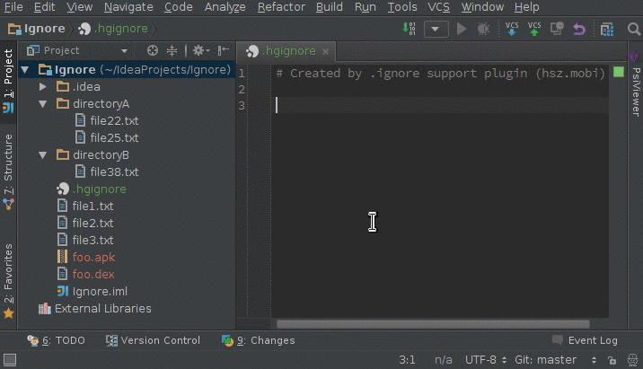

### 7. GitToolBox

**Ne işe yarar:** Git entegrasyonunu zenginleştirir: imlecin bulunduğu satırın sonunda satır içi **blame** bilgisi (kim, ne zaman, hangi commit), proje ağacında dal/ahead-behind durumu, durum çubuğunda dal bilgisi, commit mesajı tamamlama, otomatik fetch.

**Kullanım:**
* Kendiliğinden çalışır. Ayarlar: **Settings › Version Control › GitToolBox**
* İnternetsiz ortamda, ulaşılabilir bir git sunucusu yoksa **Auto Fetch**'i kapatın.
* ⚠️ Freemium bir eklentidir. Temel özellikler ücretsizdir. Bazı gelişmiş özellikler lisans ister ve lisans doğrulaması internet gerektirir.

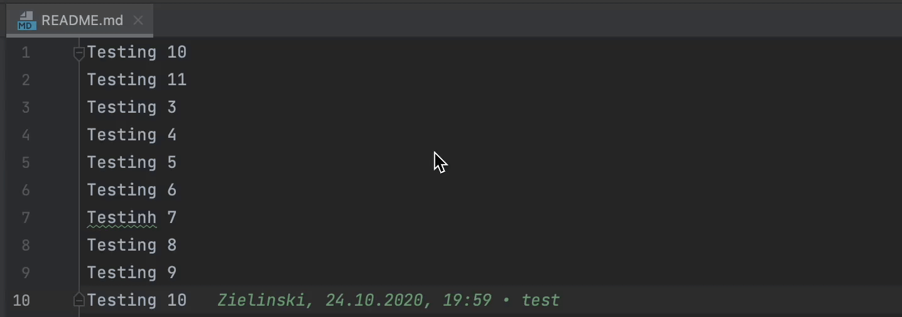
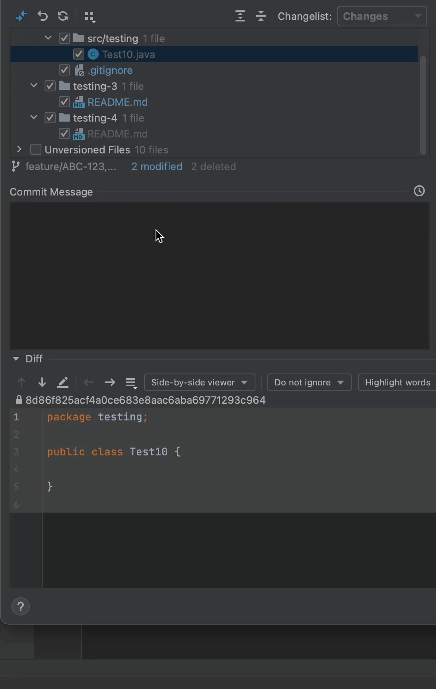

### 8. Maven Helper

**Ne işe yarar:** `pom.xml` için **Dependency Analyzer** sekmesi ekler. Bağımlılık çakışmalarını (aynı kütüphanenin farklı sürümleri) listeler, bağımlılık ağacını gösterir ve tek tıkla `<exclusion>` ekler. Ayrıca sağ tık menüsünden hedefleri (goal) hızlıca çalıştırmayı sağlar.

**Kullanım:**
* Bir `pom.xml` açın → editörün altındaki **Dependency Analyzer** sekmesine geçin.
* **Conflicts** görünümünde çakışmalar listelenir → sağ tık → **Exclude**.
* Proje ağacında veya editörde sağ tık → **Run Maven** / **Debug Maven**.
* İnternetsiz ortamda bağımlılıkların yerel `~/.m2` deposunda veya kurum içi Nexus/Artifactory'de bulunması gerekir.

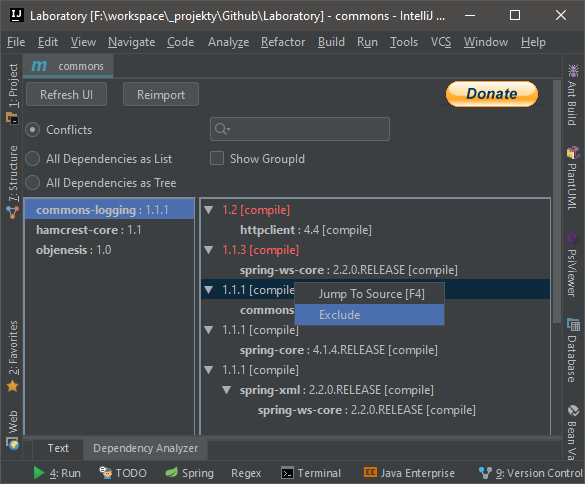
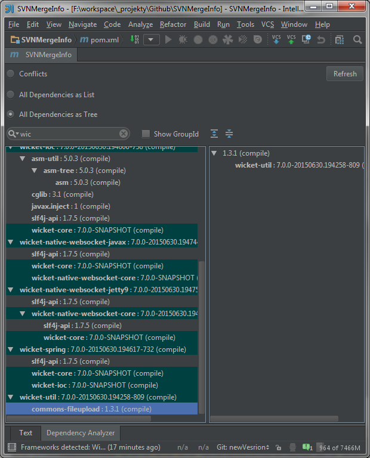

### 9. EnvFile

**Ne işe yarar:** Run/Debug yapılandırmalarına `.env`, `.json` veya `.yaml` dosyalarından ortam değişkeni yükler. Değişkenleri tek tek elle yazmanız gerekmez.

**Kullanım:**
* **Run › Edit Configurations…** → yapılandırmayı seçin → **EnvFile** sekmesi
* **Enable EnvFile** işaretleyin → **+** ile `.env` dosyasını ekleyin.

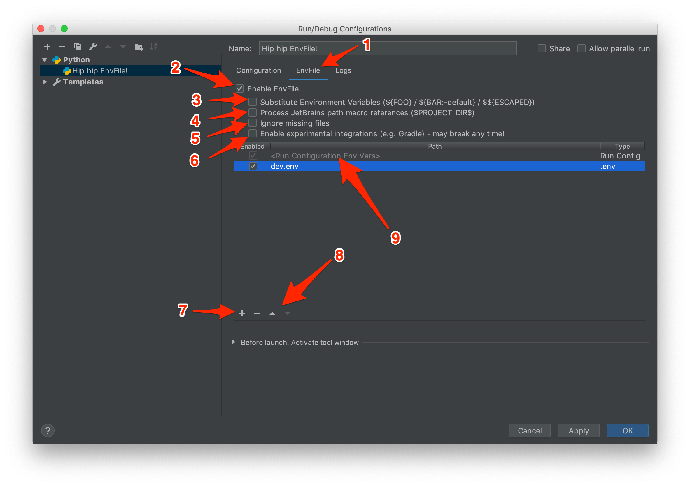

### 10–11. SonarQube for IDE, CheckStyle-IDEA

→ [Kod kalitesi araçları](#kod-kalitesi-araçları) bölümüne bakın.

### 12. GenerateAllSetter

**Ne işe yarar:** Bir nesne değişkeni için tüm `setXxx(...)` çağrılarını (varsayılan değerlerle veya boş) tek seferde üretir. Ayrıca iki nesne arasında getter → setter dönüşümü (DTO ↔ Entity) için kod üretir. Lombok `@Data` sınıflarıyla da çalışır.

**Kullanım:**
* `User user = new User();` satırında değişken adının üstüne gelin → `Alt+Enter`
* **Generate all setter with default value** veya **Generate all setter no default value** seçin.
* Bir metotta `return` tipi ve parametre farklıysa → `Alt+Enter` → **Generate setter getter converter**

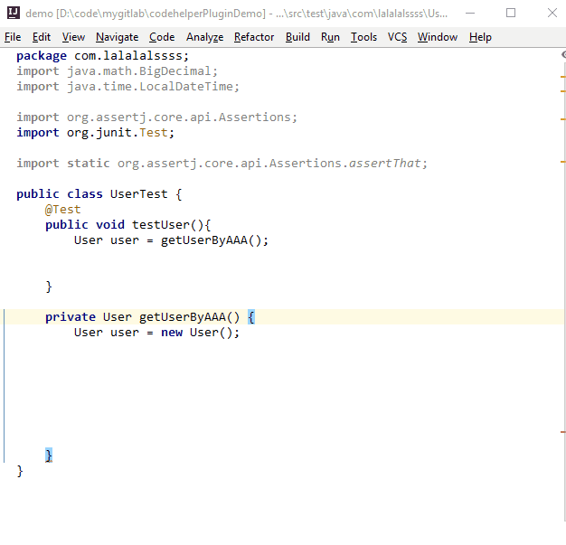
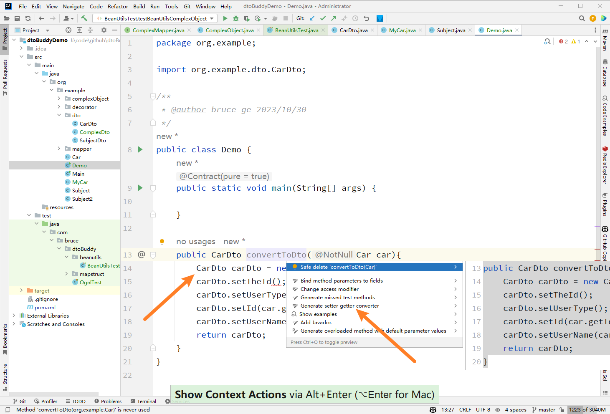

### 13. Spring Boot Assistant

**Ne işe yarar:** IntelliJ'in ücretsiz sürümünde Spring desteği sınırlıdır. Bu eklenti `application.properties` ve `application.yml` dosyalarında Spring Boot ayar anahtarları için **otomatik tamamlama**, belge gösterimi ve kaynağa gitme özelliği ekler.

**Kullanım:**
* Projenin Maven/Gradle bağımlılıkları çözülmüş (yerel depoda) olmalıdır. Eklenti, bağımlılık jar'larındaki `spring-configuration-metadata.json` dosyalarını okur.
* `application.yml` içinde yazmaya başlayın, örneğin `server.` → öneriler gelir. `Ctrl+Q` ile açıklamayı görürsünüz.

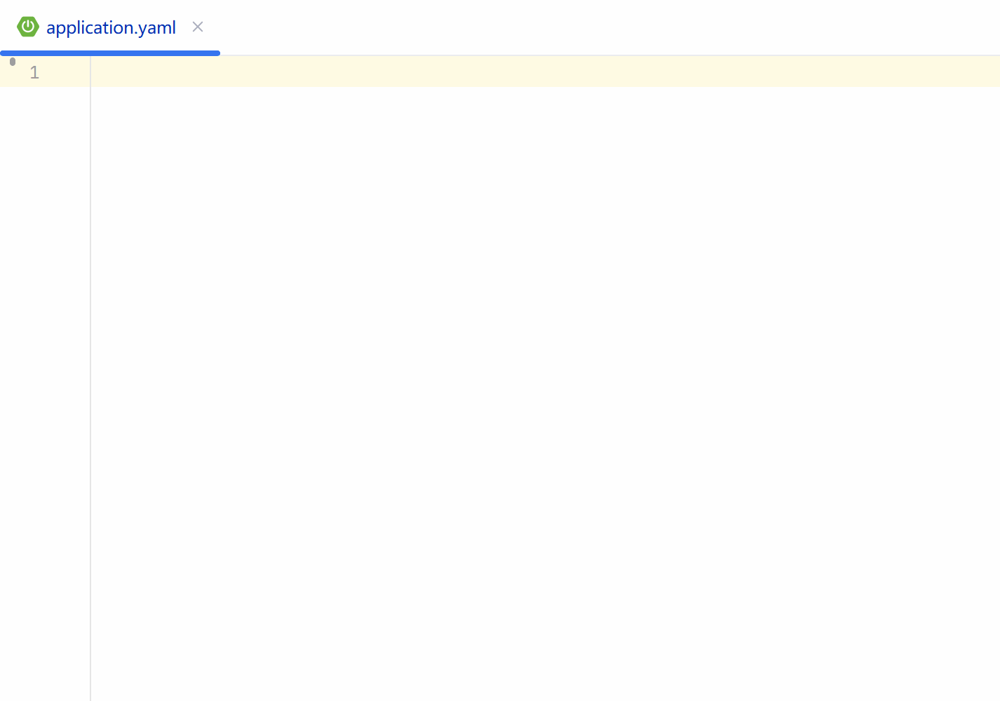

### 14. MyBatisX

**Ne işe yarar:** MyBatis kullanan projelerde Mapper arayüzü ile XML mapper arasında satır kenarındaki (gutter) simgelerle gezinmeyi sağlar. Eksik XML ifadelerini üretir ve `#{}` parametrelerini tamamlar.

**Kullanım:**
* Mapper arayüzündeki metodun yanındaki kuş simgesine tıklayın → XML'deki karşılığına gider (tersi de çalışır).
* Metot adının üzerinde `Alt+Enter` → **Generate statement**.

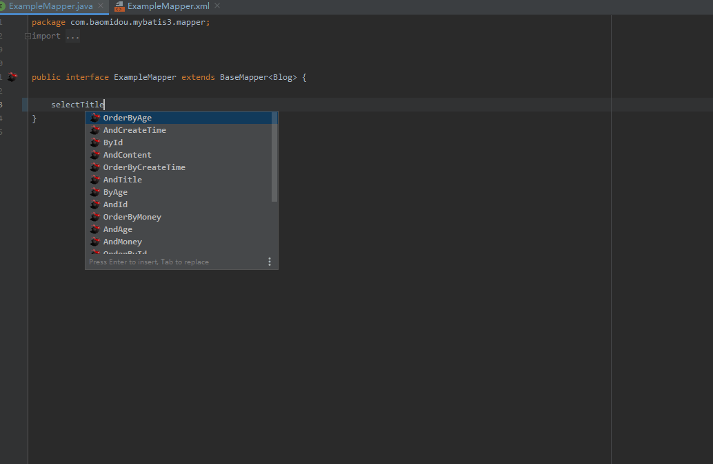

### 15. Database Navigator (DBN)

**Ne işe yarar:** Ultimate'taki "Database Tools" eklentisi ücretsiz sürümde yoktur. DBN onun yerine geçen tam bir veritabanı istemcisidir: şema gezgini, SQL konsolu, tablo verisi düzenleme, PL/SQL desteği, sorgu planı.

**Gömülü JDBC sürücüleri (internet gerekmez):** Oracle (ojdbc17), PostgreSQL 42.7, MySQL Connector/J 9.5, SQLite 3.53.

**Kullanım:**
* **View › Tool Windows › DB Browser**
* **+** → bağlantı türünü seçin (Oracle, PostgreSQL, MySQL, SQLite veya Generic JDBC) → host, port, kullanıcı ve parola bilgilerini girin.
* Başka bir veritabanı (ör. MS SQL, DB2) için **Driver source: External** seçip ilgili sürücü jar'ını diskten gösterin.
* Bağlantıya sağ tık → **Open SQL Console** ile sorgu yazın, `Ctrl+Enter` ile çalıştırın.

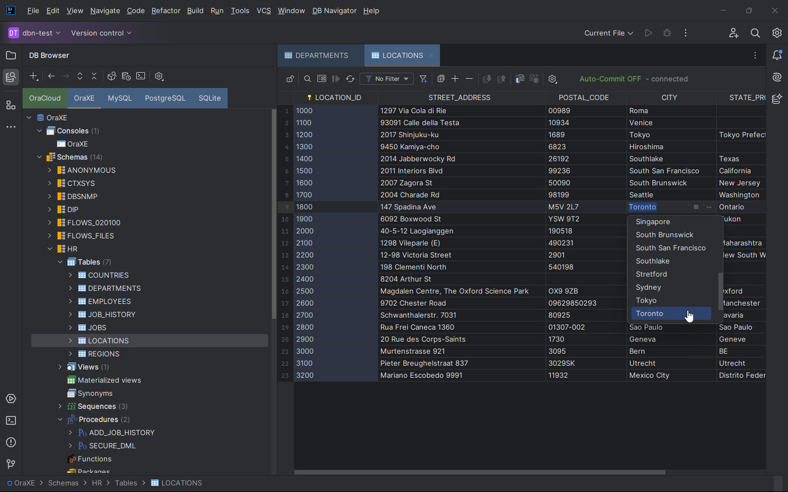
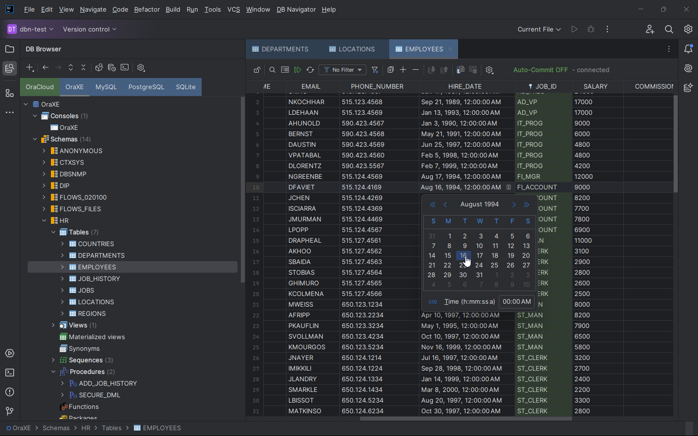

### 16. CSV Editor

**Ne işe yarar:** CSV ve TSV dosyalarına sözdizimi denetimi, sütun vurgusu ve **tablo görünümünde düzenleme** ekler. Ayraç (`,` `;` `|` `\t`) otomatik algılanır.

**Kullanım:** Bir `.csv` dosyası açın → editörün altındaki **Table Editor** sekmesi. Ayarlar: **Settings › Editor › CSV/TSV/PSV**

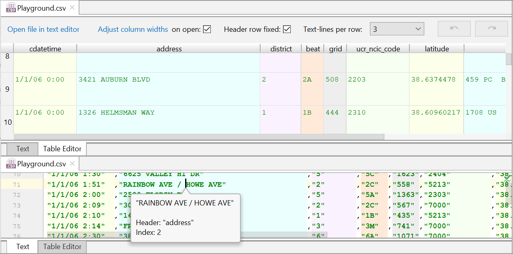
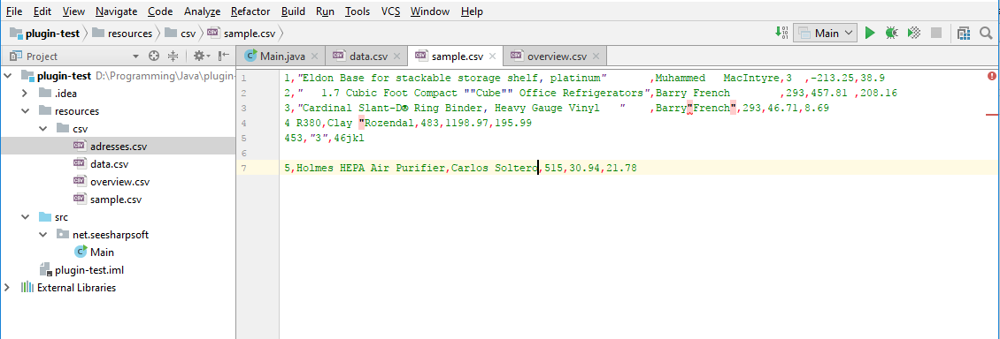

### 17. Rainbow CSV

**Ne işe yarar:** CSV dosyalarında her sütunu farklı renkle gösterir. Çok sütunlu dosyalarda hangi değerin hangi sütuna ait olduğu bir bakışta anlaşılır. CSV Editor ile birlikte kullanılabilir.

**Kullanım:** Kendiliğinden çalışır.

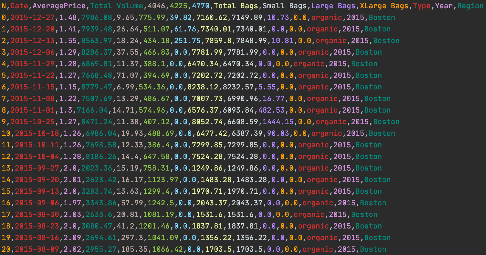

### 18. PlantUML Integration

**Ne işe yarar:** `.puml` / `.plantuml` dosyalarını ve kod içindeki `@startuml … @enduml` bloklarını canlı önizler. Sınıf, sıra (sequence), aktivite, bileşen ve durum diyagramlarını destekler. Diyagramları PNG/SVG olarak dışa aktarır. PlantUML (MIT sürümü 1.2026.8) eklentinin içinde gelir.

**Kullanım:**
* **File › New › PlantUML File** → türü seçin.
* Sağdaki **PlantUML** aracı canlı önizleme gösterir.
* ⚠️ Sınıf, bileşen ve durum gibi bazı diyagram türleri **Graphviz** ister. İnternetsiz makinede `graphviz` paketini yerel depodan kurun ya da dosyanın başına şunu ekleyerek Java tabanlı yerleşik düzenleyiciyi kullanın:
  ```
  @startuml
  !pragma layout smetana
  ...
  @enduml
  ```

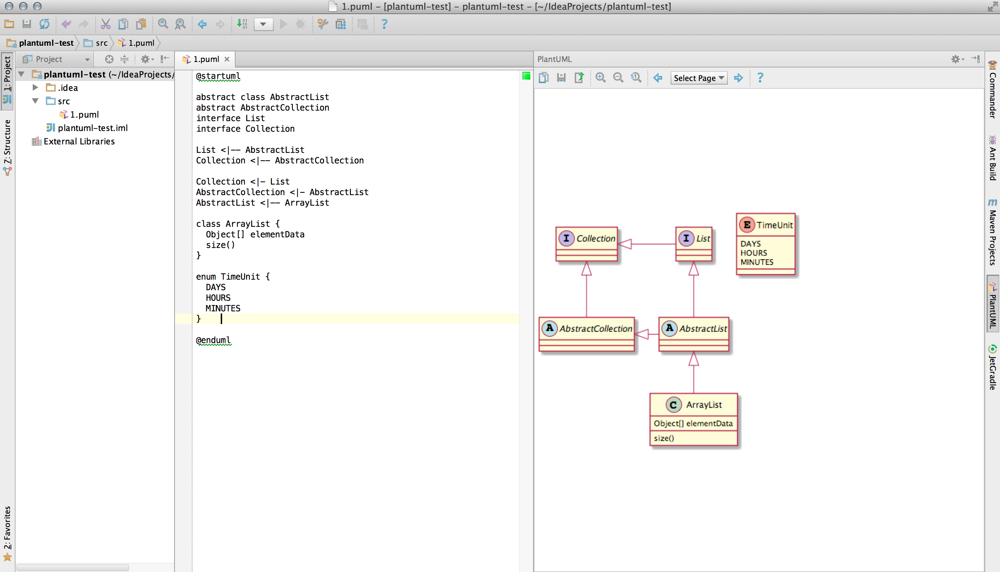
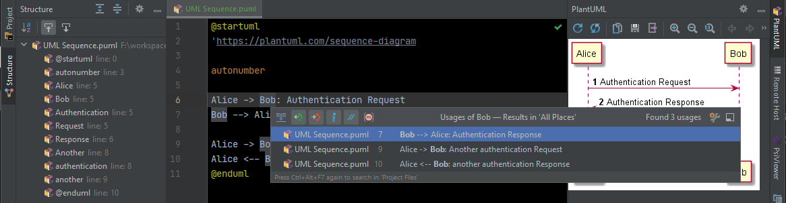

### 19. Mermaid Visualizer

**Ne işe yarar:** Mermaid diyagramlarını (akış, sıra, sınıf, ER, Gantt…) IDE içinde çizer. Markdown dosyalarındaki ` ```mermaid ` blokları önizlemede diyagram olarak görünür. `mermaid.js` eklentinin içinde gelir, CDN'e bağlanmaz.

**Kullanım:** Markdown dosyasına ` ```mermaid ` bloğu yazın → Markdown önizlemesini açın.

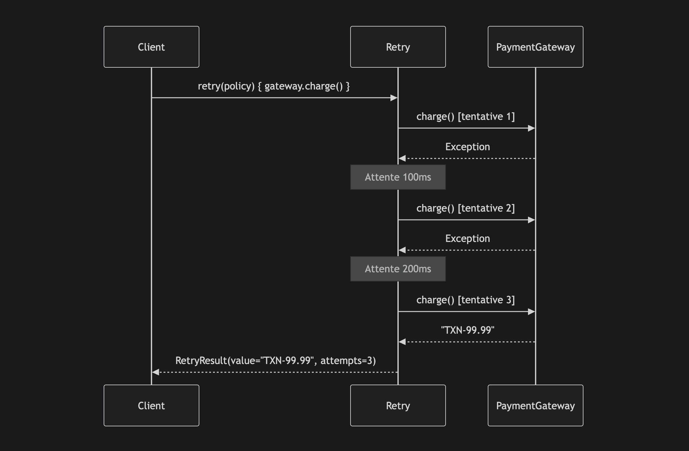
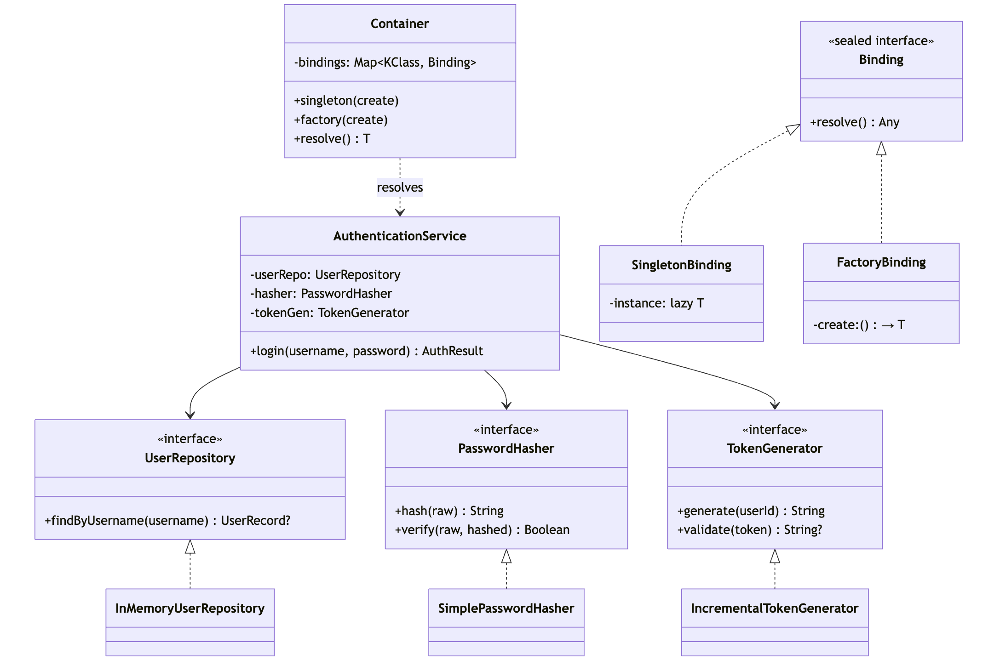

### 20. Atom Material Icons

**Ne işe yarar:** Proje ağacındaki dosya ve klasör ikonlarını dosya türüne göre ayırt edici, renkli ikonlarla değiştirir (pom.xml, Dockerfile, .yml, test klasörleri…).

**Kullanım:** Kendiliğinden çalışır. Ayarlar: **Settings › Appearance & Behavior › Atom Material Icons**

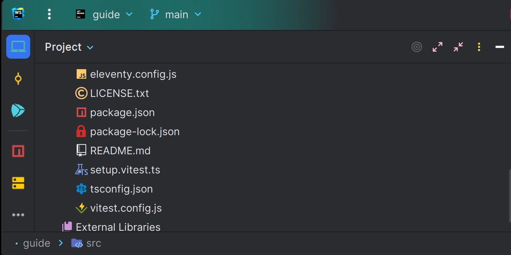
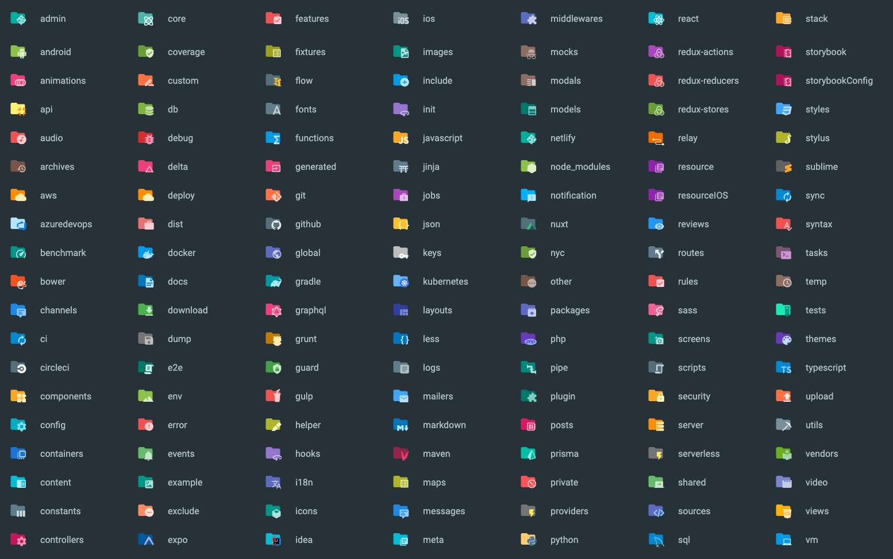

### 21. One Dark Theme

**Ne işe yarar:** Atom editörünün popüler "One Dark" koyu temasını IDE'ye getirir.

**Kullanım:** **Settings › Appearance & Behavior › Appearance › Theme** → **One Dark**

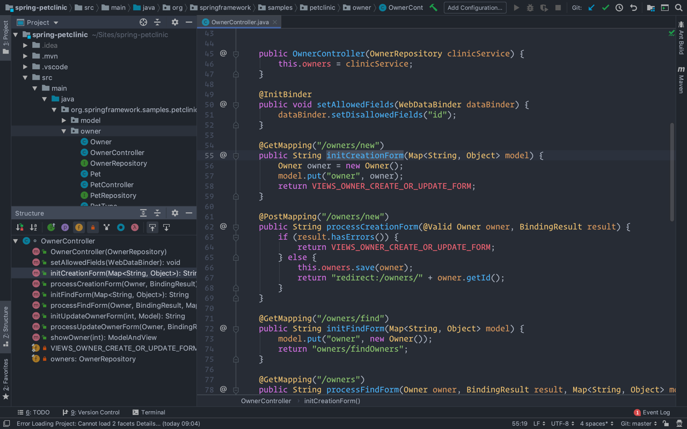
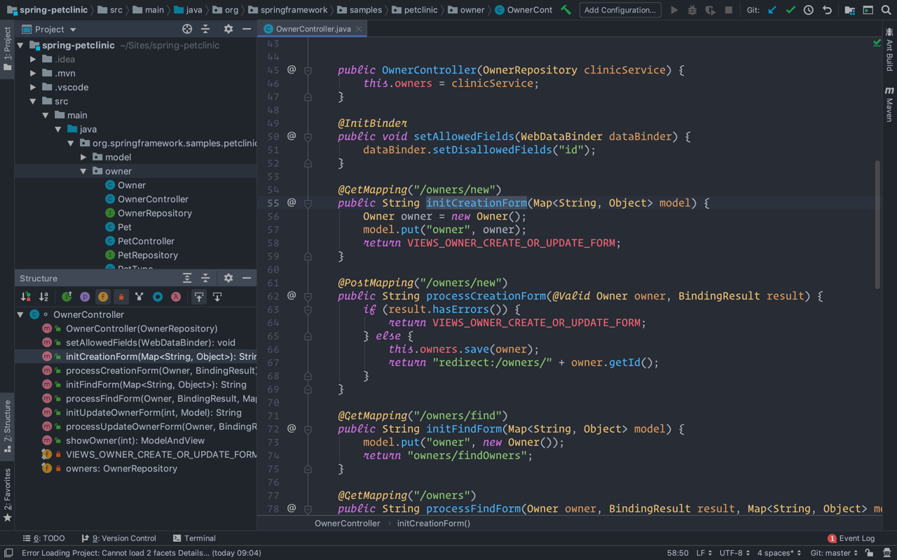

---

## Kod kalitesi araçları

Dört araç birbirini tamamlar:

| Araç | Neye bakar | Ne zaman çalışır |
|---|---|---|
| **SonarQube for IDE** | Hata, güvenlik açığı ve kod kokusu. Çok dilli ve kapsamlı. | Yazarken, anlık |
| **SpotBugs** | **Derlenmiş bytecode** üzerinde hata kalıpları: null, eşzamanlılık, kaynak sızıntısı. Find Security Bugs ile güvenlik. | Elle tetiklenir (önce derleme gerekir) |
| **PMD** | **Kaynak kod** üzerinde kalıplar: kullanılmayan kod, karmaşıklık, en iyi uygulamalar. | Elle tetiklenir |
| **Checkstyle** | Kod **stili**: biçim, isimlendirme, Javadoc. | Yazarken ve elle |

### 10. SonarQube for IDE (eski adı SonarLint)

**Ne işe yarar:** Java, Kotlin, JavaScript/TypeScript, Python, HTML, XML ve daha birçok dilde **yazarken** hata, güvenlik açığı ve kod kokusu tespit eder. Her bulgu için neden sorun olduğunu ve nasıl düzeltileceğini anlatır. Analizciler eklentinin içinde gelir (~274 MB).

**Kullanım:**
* Kendiliğinden çalışır. Sorunlu kod altı çizili görünür, `Alt+Enter` ile açıklama ve hızlı düzeltme gelir.
* **View › Tool Windows › SonarQube for IDE** → **Current File** / **Report** sekmeleri
* Tüm projeyi taramak için: sağ tık → **SonarQube for IDE › Analyze with SonarQube for IDE**
* Ayarlar ve kural açma/kapama: **Settings › Tools › SonarQube for IDE**
* İnternetsiz ortamda **Connected Mode** (SonarQube Server/Cloud bağlantısı) kurmayın; tek başına mod tam çalışır. Kurum içinde bir SonarQube Server varsa ona bağlanabilirsiniz.

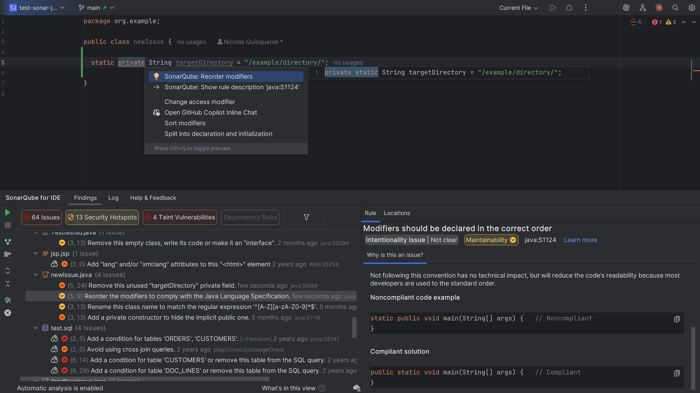
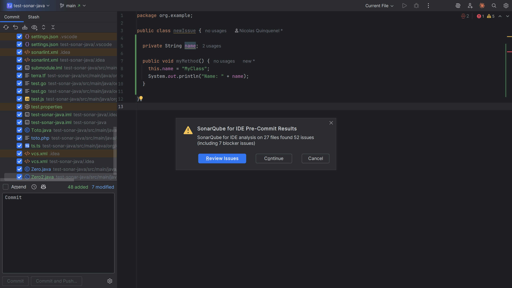

### 11. CheckStyle-IDEA

**Ne işe yarar:** Kodu Checkstyle kurallarına göre denetler: girinti, satır uzunluğu, isimlendirme, Javadoc zorunlulukları, import sırası gibi. Sorunlar editörde anlık işaretlenir. **Checkstyle 14.4.0 eklentinin içinde gelir.**

**Kullanım:**
1. **Settings › Tools › Checkstyle**
   * **Checkstyle version:** `14.4.0` seçin. Diğer sürümler ilk kullanımda internetten indirilir, internetsiz ortamda çalışmaz.
   * **Configuration File:** hazır *Sun Checks* / *Google Checks* ya da **+** ile yerel bir `checkstyle.xml` ekleyip aktif yapın.
2. **View › Tool Windows › CheckStyle** → **Check Current File**, **Check Module**, **Check Project**, **Check All Modified Files**
3. Commit penceresinde "Scan with Checkstyle" seçeneği ile commit öncesi tarama yapılabilir.

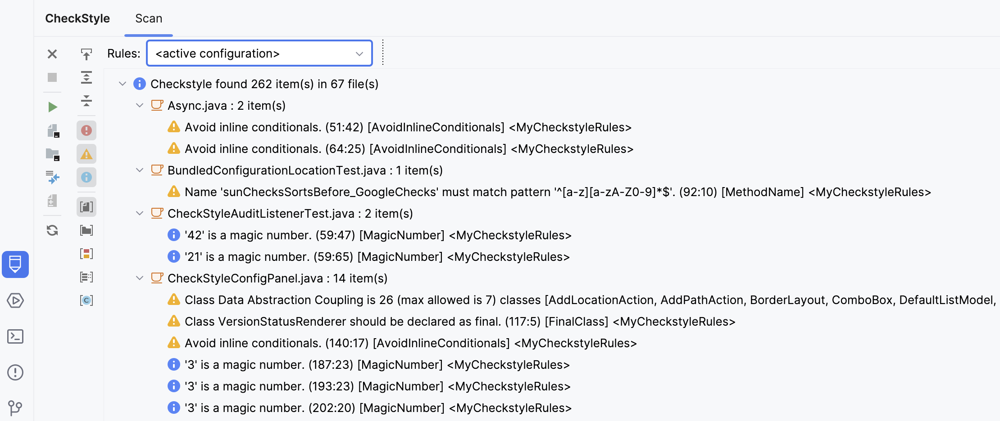
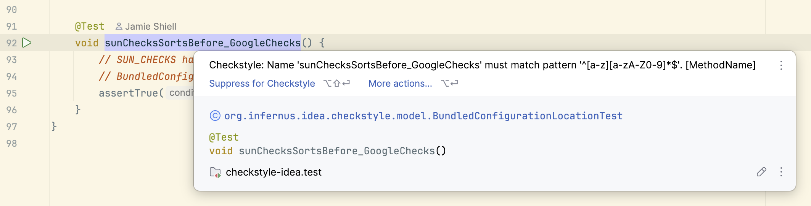

### 22. SpotBugs (spotbugs-idea) + kural jar'ları

**Ne işe yarar:** FindBugs'ın devamı olan SpotBugs, derlenmiş Java sınıflarını analiz ederek olası hataları bulur: null pointer, `equals`/`hashCode` tutarsızlığı, kapatılmayan stream'ler, senkronizasyon hataları gibi. Eklenti **SpotBugs 4.8.6** motorunu içinde getirir.

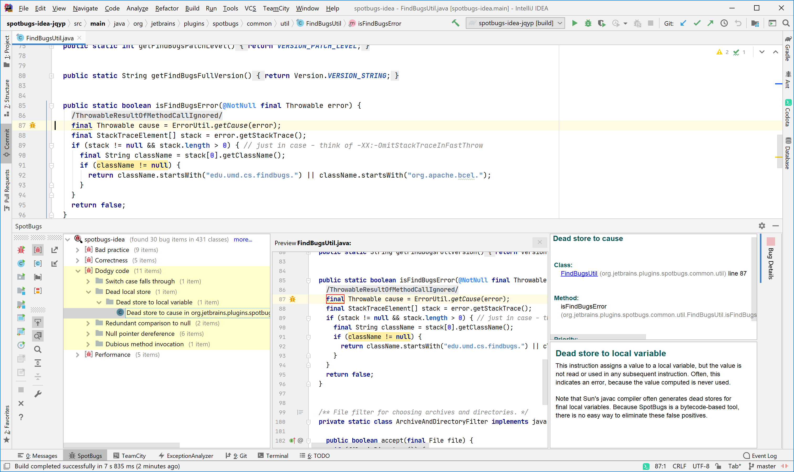

**Kullanım:**
1. Önce projeyi derleyin (**Build › Build Project**, `Ctrl+F9`). SpotBugs `.class` dosyalarını analiz eder.
2. Proje ağacında veya editörde sağ tık → **SpotBugs** menüsünden:
   * **Analyze Selected Files**: seçili dosya(lar)
   * **Analyze Class Under Cursor**: imlecin bulunduğu sınıf
   * **Analyze Module Files (Not) Including Test Sources**: modül
   * **Analyze Project Files (Not) Including Test Sources**: tüm proje
   * **Analyze All Modified Files**: değişen dosyalar
3. Sonuçlar alttaki **SpotBugs** aracında, kategori, öncelik veya pakete göre gruplanmış olarak görünür. Bir bulguya çift tıklayınca koda gidersiniz.

**Ek kural setleri (rule jar'lar):**

SpotBugs'ın kendi kurallarına ek olarak iki popüler kural paketi vardır:

* **Find Security Bugs** (`findsecbugs-plugin`): 140'tan fazla güvenlik kuralı. SQL/LDAP/XPath/komut enjeksiyonu, XSS, zayıf şifreleme, sabit parola, güvensiz rastgele sayı, XXE, path traversal, Spring/JAX-RS/servlet açıkları.
* **sb-contrib** (eski adı fb-contrib): yüzlerce ek kural. Performans, yanlış API kullanımı, gereksiz nesne oluşturma, collection hataları.

> Eklentinin içinde eski sürümleri (findsecbugs 1.12.0, fb-contrib 7.6.0) zaten bulunur. `spotbugs-rules/` klasöründeki daha **yeni** sürümleri eklemeniz önerilir.

**Kural jar'larını IDE'ye ekleme:**

1. Klasörü kalıcı bir yere kopyalayın, örneğin `~/tools/spotbugs-rules/`.
2. **Settings › Tools › SpotBugs** → **Plugins** sekmesi
3. **+ (Install Plugin)** → `spotbugs-rules/spotbugs-4.8/` altından seçin:
   * `findsecbugs-plugin-1.14.0.jar`
   * `sb-contrib-7.6.9.jar`
4. Eklenen kural setlerini işaretleyin, eklentinin içindeki eski sürümleri (fb-contrib 6.2.1 / 7.6.0, findsecbugs 1.12.0) **devre dışı bırakın**. Aynı kuralın iki sürümü birlikte açık olmasın.
5. **Detector** sekmesinden istemediğiniz kuralları kapatabilirsiniz. **Report** sekmesinden minimum öncelik ve kategori seçilir.

> ⚠️ **Sürüm uyumu:** IDE eklentisi SpotBugs **4.8.6** kullanır. `sb-contrib 7.7.x` SpotBugs 4.9 için derlendiğinden IDE'de hata verebilir. Bu yüzden IDE için **`spotbugs-4.8/`** klasörünü kullanın.

**Maven derlemesinde aynı kuralları kullanma** (`spotbugs-4.9/`): `spotbugs-maven-plugin` 4.9.x sürümleri SpotBugs 4.9 kullanır. Kurum içi Nexus'a yüklediğiniz veya yerel `~/.m2`'de bulunan kural jar'larını şöyle bağlarsınız:

```xml
<plugin>
  <groupId>com.github.spotbugs</groupId>
  <artifactId>spotbugs-maven-plugin</artifactId>
  <version>4.9.8.5</version>   <!-- SpotBugs 4.9.8 kullanır; yerel depoda bulunmalı -->
  <configuration>
    <plugins>
      <plugin>
        <groupId>com.h3xstream.findsecbugs</groupId>
        <artifactId>findsecbugs-plugin</artifactId>
        <version>1.14.0</version>
      </plugin>
      <plugin>
        <groupId>com.mebigfatguy.sb-contrib</groupId>
        <artifactId>sb-contrib</artifactId>
        <version>7.7.4</version>
      </plugin>
    </plugins>
  </configuration>
</plugin>
```

Jar'ları yerel `~/.m2` deposuna elle yüklemek için (Maven kuruluysa):

```bash
mvn install:install-file -Dfile=spotbugs-rules/spotbugs-4.9/findsecbugs-plugin-1.14.0.jar \
    -DgroupId=com.h3xstream.findsecbugs -DartifactId=findsecbugs-plugin -Dversion=1.14.0 -Dpackaging=jar
mvn install:install-file -Dfile=spotbugs-rules/spotbugs-4.9/sb-contrib-7.7.4.jar \
    -DgroupId=com.mebigfatguy.sb-contrib -DartifactId=sb-contrib -Dversion=7.7.4 -Dpackaging=jar
```

### 23. PMD

**Ne işe yarar:** PMD, kaynak kodu (derlemeye gerek kalmadan) kural setlerine göre tarar. Kullanılmayan değişken, import ve özel metotları, boş `catch` bloklarını, gereksiz karmaşıklığı, kopyala-yapıştır kalıplarını ve en iyi uygulama ihlallerini bulur. Eklenti **PMD 7.21.0** motorunu, Java ve Kotlin kurallarıyla birlikte içinde getirir.

Marketplace'te ekran görüntüsü yok. Aşağıdaki görsel sonuç penceresini **temsili** olarak gösterir:

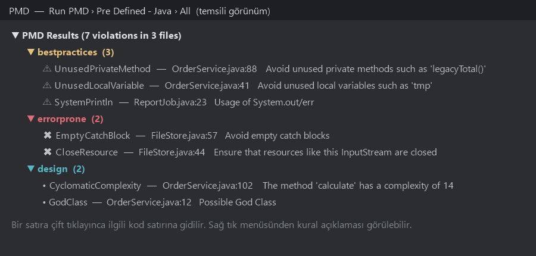

**Kullanım:**
1. Proje ağacında bir dosya, paket veya modüle sağ tık → **Run PMD** →
   * **Pre Defined - Java** → `All` veya bir kategori (*bestpractices, codestyle, design, documentation, errorprone, multithreading, performance, security*)
   * **Pre Defined - Kotlin**
   * **Custom Rule** → kendi ruleset XML'iniz
2. Sonuçlar alttaki **PMD** aracında kurala göre gruplanmış olarak görünür. Çift tıklayınca ilgili satıra gidersiniz.
3. Kendi kural setinizi eklemek için: **Settings › Tools › PMD** → **RuleSets** sekmesi → **+** → yerel XML dosyası. İnternetsiz ortamda ruleset içinde URL yerine `category/java/bestpractices.xml` gibi classpath referansları veya yerel dosya yolu kullanın.
4. **Options** sekmesinden hedef Java sürümü ve "Skip test sources" gibi seçenekler ayarlanır.

Örnek minimal ruleset (`pmd-kurallar.xml`):

```xml
<?xml version="1.0"?>
<ruleset name="Proje Kurallari"
         xmlns="http://pmd.sourceforge.net/ruleset/2.0.0"
         xmlns:xsi="http://www.w3.org/2001/XMLSchema-instance"
         xsi:schemaLocation="http://pmd.sourceforge.net/ruleset/2.0.0 https://pmd.sourceforge.io/ruleset_2_0_0.xsd">
  <description>Takim kurallari</description>
  <rule ref="category/java/bestpractices.xml"/>
  <rule ref="category/java/errorprone.xml"/>
  <rule ref="category/java/security.xml"/>
  <rule ref="category/java/design.xml">
    <exclude name="LawOfDemeter"/>
  </rule>
</ruleset>
```

> `xsi:schemaLocation` içindeki URL yalnızca bilgi amaçlıdır. PMD bu adrese bağlanmaz, ruleset internetsiz çalışır.

---

## Opsiyonel eklentiler

`plugins/optional/` klasöründekiler listede seçildi ama **tamamen internetsiz ortamda işe yaramazlar** veya ek bileşen isterler. Betikler bunları yalnızca `--optional` / `-Optional` ile kurar (Copilot'un yalnızca çalışılan işletim sistemine uygun paketini); grafik kurulum programı ise ilgili kutucuk işaretlenince gösterir.

### GitHub Copilot (Linux x64 / Windows x64)

**Ne işe yarar:** Yapay zekâ destekli kod tamamlama ve sohbet.
**Gereksinim:** GitHub hesabı ve Copilot aboneliği, ayrıca GitHub sunucularına **internet erişimi**. Tamamen internetsiz ortamda çalışmaz. İki paket var: `…-linux-x64.zip` ve `…-windows-x64.zip`. Kurulum programı ve betikler işletim sisteminize uygun olanı seçer.
**Kullanım:** Kurulumdan sonra sağ alttaki Copilot simgesi → **Login to GitHub**.

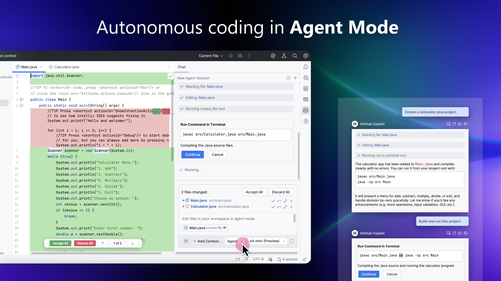
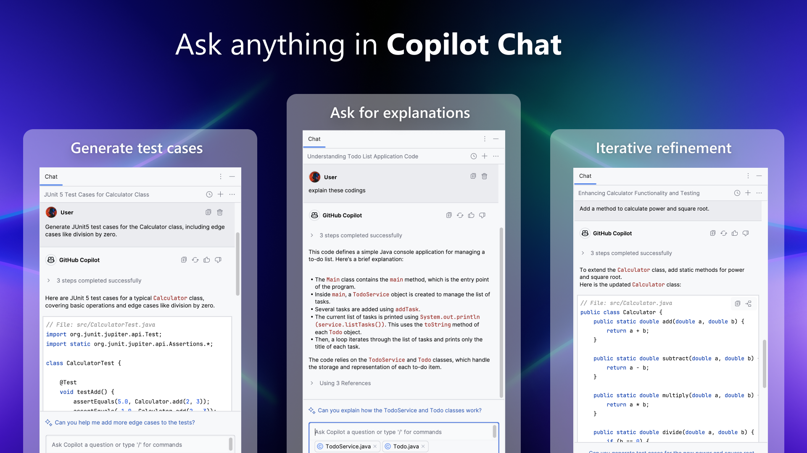

### Claude Code [Beta]

**Ne işe yarar:** Anthropic'in Claude Code komut satırı aracını IDE'ye bağlar: diff'leri IDE'nin diff görünümünde açar, seçili kodu ve tanıları Claude'a paylaşır.
**Gereksinim:** Makinede `claude` CLI kurulu olmalı ve Anthropic API'sine (veya kurum içi yönlendirilmiş bir uç noktaya) ağ erişimi bulunmalı.
**Kullanım:** IDE'nin terminalinde `claude` komutunu çalıştırın; eklenti otomatik bağlanır.

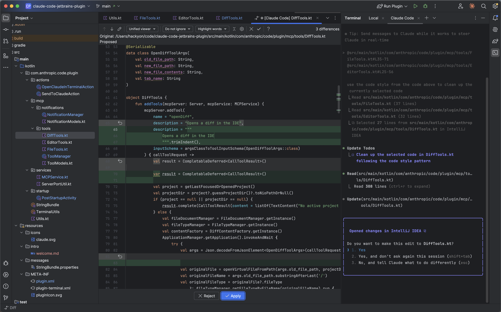
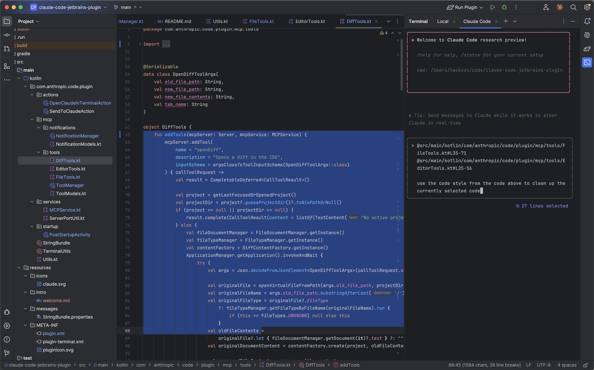

### Line Profiler

**Ne işe yarar:** Python kodunu satır satır profiller, her satırın süresini editörde renkli gösterir.
**Gereksinim:** IDE'de **Python eklentisinin** (`com.intellij.modules.python`) bulunması ve projede `line_profiler` Python paketinin kurulu olması. Python eklentisi yoksa bu eklenti yüklenmez.

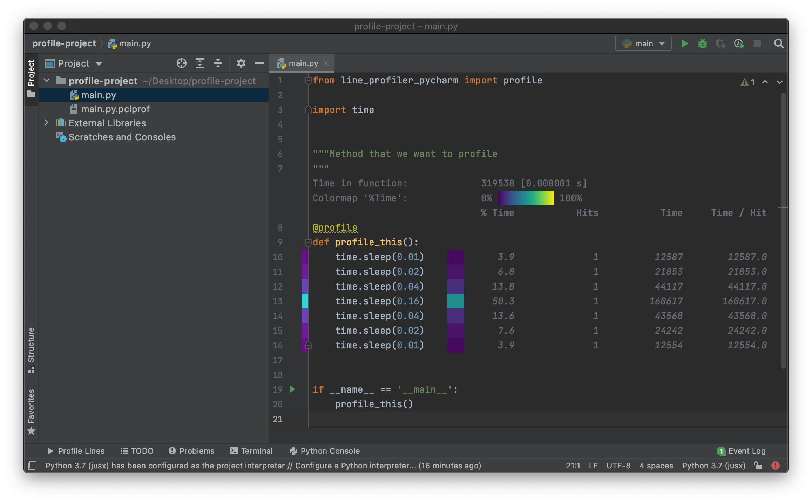
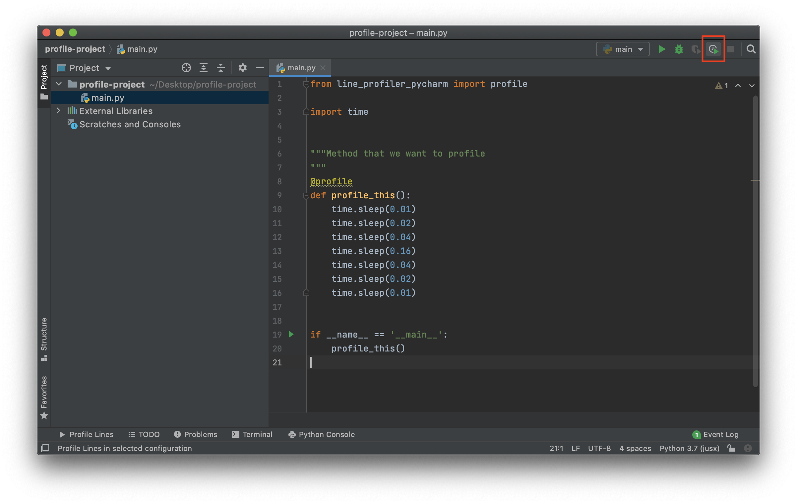

---

## Kurulum arayüzünü değiştirme

* **Eklenti açıklamalarını, görselleri veya önerilen işaretini** değiştirmek için `catalog.json` dosyasını düzenleyin. Programı yeniden derlemeye gerek yoktur. Her metnin `en` ve `tr` sürümü vardır.
* **Programın kendisini** değiştirdiyseniz (JDK 11+ gerekir):

```bash
javac --release 11 -encoding UTF-8 -d build src/PluginInstaller.java
jar --create --file plugin-installer.jar --main-class PluginInstaller -C build .
```

* Arayüzsüz denetim: `java -jar plugin-installer.jar --test --root .` komutu tüm paket dosyalarını ve görselleri kontrol eder, kurulu durumları listeler.
* README ekran görüntüleri: `java -jar plugin-installer.jar --root . --lang tr --snapshot docs/images/installer --select pmd,dbn --show dbn` pencereyi ekranda göstermeden `installer-main.png` ve `installer-preview.png` olarak kaydeder.

---

## Sorun giderme

| Sorun | Çözüm |
|---|---|
| Windows: `plugin-installer.cmd` IntelliJ IDEA'yı bulamadı diyor | Kurulum dizinini verin: `.\plugin-installer.cmd -IdeaHome "C:\…\IntelliJ IDEA 2026.2"` (içinde `jbr\` ve `product-info.json` olan dizin). |
| Windows: "bu sistemde betik çalıştırma devre dışı" | `.ps1` yerine `.cmd` dosyalarını başlatın; PowerShell'i yalnızca o betik için `-ExecutionPolicy Bypass` ile çalıştırırlar. |
| Windows: `install-plugins.cmd` yol hatasıyla duruyor | Hedef yol PowerShell 5.1 için çok uzun (260 karakter). Daha kısa bir `-Target` veya grafik kurulum programını kullanın. |
| `plugin-installer.sh`: "Java 11+ bulunamadı" | IDEA kurulum dizinini verin: `./plugin-installer.sh --idea-home /opt/idea-…` (içinde `jbr/` ve `product-info.json` olan dizin). |
| Arayüz yazıları çok küçük (HiDPI ekran) | `GDK_SCALE=2 ./plugin-installer.sh` |
| "Plugin X is incompatible with this installation" | IDE sürümünüz 2026.2'den eskiyse eklentiler yüklenmeyebilir. **Help › About** ile build numarasını kontrol edin (262.x veya üzeri olmalı). |
| "Plugin requires plugin Y to be installed" | Gerekli IDE bileşeni (ör. Maven, YAML, Markdown) **Settings › Plugins › Installed** altında devre dışı bırakılmış olabilir, etkinleştirin. |
| Zip seçince "Fail to load plugin descriptor" | Zip'i açıp içindekini değil, **zip dosyasının kendisini** seçin. |
| Kurduktan sonra eklenti görünmüyor | IDE'yi yeniden başlatın. Betikle kurduysanız `--target` dizininin doğru olduğundan emin olun. Doğru dizini **Help › Show Log in Files** ile açılan `idea.log` içinde `plugins` yolu olarak görebilirsiniz. |
| SpotBugs "No classes found to analyze" | Önce projeyi derleyin (`Ctrl+F9`). |
| SpotBugs kural jar'ı eklenince hata | `spotbugs-4.9/` yerine **`spotbugs-4.8/`** klasöründeki jar'ları kullanın. |
| Checkstyle "Could not download Checkstyle version" | **Settings › Tools › Checkstyle** → sürüm olarak gömülü **14.4.0**'ı seçin. |
| PlantUML "Cannot find Graphviz" | `graphviz` paketini kurun ya da diyagrama `!pragma layout smetana` ekleyin. |

---

*Hazırlanma tarihi: 24.11.2026; Windows desteği, İngilizce arayüz ve sürüm aralıkları 25.11.2026'da eklendi · Kaynak: JetBrains Marketplace (build IU-262) ve Maven Central*
